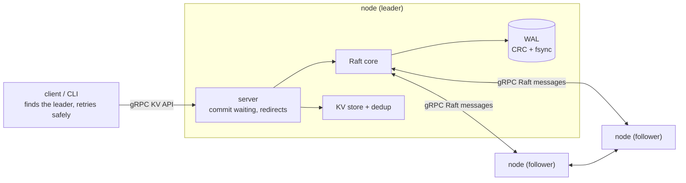
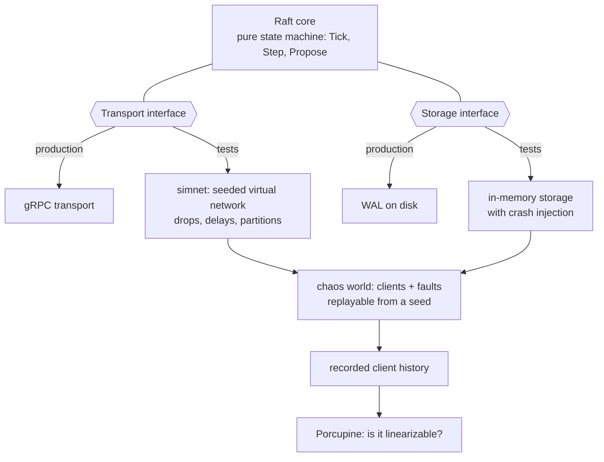

# RaftKV

[](https://github.com/ritvik-devireddy/RaftKV/actions/workflows/ci.yml)
[](https://github.com/ritvik-devireddy/RaftKV/actions/workflows/soak.yml)

A linearizable key-value store on a from-scratch Raft implementation in Go, built so that its correctness can be **tested under failure and checked, not just claimed**.

A small cluster of nodes acts as one database (`Get`, `Put`, `Delete`, `CompareAndSwap`). Writes are replicated with Raft, saved to a checksummed write-ahead log before they are acknowledged, and survive node crashes, restarts, and network partitions. Retried requests are applied exactly once.

## What has been verified

The point of the project is the evidence. Everything below is a test you can run.

| Property | How it is checked |
|---|---|
| At most one leader per term; Log Matching; State Machine Safety | Checked after every event in whole-cluster simulations with message loss, partitions and crashes, over hundreds of seeds |
| An acknowledged write is never lost to a crash | A node is crashed at **every** storage operation it performs, both before and after the operation reaches the disk, then must restart from disk alone and converge |
| The write-ahead log survives torn and corrupt writes | The log file is cut at every byte offset and bit-flipped; recovery must return exactly the records that were fully written, or report corruption |
| Clients see a linearizable history | 2,000 seeded chaos runs (about 1.1 million operations, with partitions, crashes and lost messages) are recorded and checked with [Porcupine](https://github.com/anishathalye/porcupine). A nightly job runs tens of thousands more on fresh seeds |
| The linearizability checker can actually fail | The harness is deliberately broken (reads served from a node's local state; retries applied twice) and the checker must flag both |
| The tests catch real bugs | Mutation testing: bugs are injected into the real code and the suite must fail (table below) |

### Mutation testing

| Injected bug | Caught by |
|---|---|
| Commit an entry without a majority | Chaos test, within a few seeds |
| Grant votes without checking the candidate's log is up to date | Chaos test, within a few seeds |
| Complete a waiting client with a different entry's result | Chaos test, within a few seeds |
| Dedup cache returns the wrong saved result | Chaos test, within a few seeds |
| Remove the Figure 8 rule (commit an old-term entry by counting replicas) | **Not** caught by 3,000 chaos seeds; caught by a targeted unit test |
| 12 mutations of the PreVote logic | 11 caught; the twelfth is equivalent (a leader's timer never advances, so another rule already covers it) |

The Figure 8 row is the lesson: random chaos finds bugs nobody thought of, and targeted tests pin the ones people know about. You need both.

### Bugs the testing found

- **A client could wait forever after its leader was deposed.** The server skipped completing waiters at no-op log entries, so a command whose log slot was taken over by a new leader's no-op was never answered. Found by a targeted test; fixed and pinned by `TestDeposedLeadersPendingCommandFails`.
- **A restarted node forced an extra election.** Seen in a live three-node demo. Without PreVote, a node that is cut off keeps raising its term and deposes a healthy leader when it returns. Reproduced first as a failing test (leader 2 in term 1 became leader 0 in term 21), then fixed with PreVote.

More detail on each is in [`docs/design.md`](docs/design.md).

## Architecture



The Raft core never reads a clock, opens a socket, or touches a file. It is driven by `Tick`, `Step` and `Propose`, and talks to the world through a `Transport` and a `Storage` interface. In production those are gRPC and the WAL. In tests they are a seeded virtual network and in-memory storage that crashes on command, so a whole cluster runs in one thread and **any failure replays exactly from its seed**:



## Features

- Leader election with randomized timeouts and **PreVote**, so a node that was cut off cannot depose a healthy leader when it returns
- Log replication with the Raft paper's commit rules, including the Figure 8 fix, and a no-op entry at the start of every term
- Crash-safe write-ahead log: CRC32C checksums, fsync before every reply, torn-write recovery, directory sync
- Persist-before-reply: terms, votes and log entries reach disk before any message that depends on them leaves the node
- Exactly-once writes: every request carries `(ClientID, Seq)`, and the replicated state machine deduplicates retries
- Reads go through the log, so they are linearizable
- gRPC API with a leader-finding client that follows redirects, a CLI, and a Docker Compose setup

## Run it

Requires Go 1.26 or newer.

```
go build ./...
go vet ./...
go test -race ./...
```

`-race` needs a C compiler on Windows (for example MinGW-w64 via MSYS2). CI runs it on Linux on every push.

### Start a three-node cluster

On Windows PowerShell, one command opens three node windows:

```
.\scripts\demo.ps1
```

Or start the nodes yourself, one per terminal:

```
go run ./cmd/raftkv-server -id 0 -listen :7001 -data data/node0 -peers localhost:7001,localhost:7002,localhost:7003
go run ./cmd/raftkv-server -id 1 -listen :7002 -data data/node1 -peers localhost:7001,localhost:7002,localhost:7003
go run ./cmd/raftkv-server -id 2 -listen :7003 -data data/node2 -peers localhost:7001,localhost:7002,localhost:7003
```

Then use the CLI (it finds the leader and follows redirects):

```
go run ./cmd/raftkv-cli put hello world
go run ./cmd/raftkv-cli get hello
go run ./cmd/raftkv-cli cas hello world there
go run ./cmd/raftkv-cli delete hello
```

Stop the leader with Ctrl+C: the other two elect a new one and reads and writes continue. Restart it and it recovers its term and log from its write-ahead log and catches up. Or run `docker compose up --build` for the same three nodes in containers.

Connections are unauthenticated and unencrypted (no TLS), which is fine for a local demo and not for a network you do not trust.

### Check linearizability yourself

```
go test ./test/linearizability -v
```

That runs 200 seeded chaos runs. For a longer soak (PowerShell):

```
$env:RAFTKV_CHAOS_SEEDS=2000; go test ./test/linearizability -run TestLinearizableUnderChaos -timeout 1h
```

If a seed ever fails, the test prints the exact command that replays it and writes an HTML visualization of the failing history.

### Regenerating the protobuf code

Only needed after editing `api/raftkv.proto`. Install `protoc` (`winget install protobuf`) and the two plugins (`go install google.golang.org/protobuf/cmd/protoc-gen-go@latest` and `go install google.golang.org/grpc/cmd/protoc-gen-go-grpc@latest`), then run `scripts/gen-proto.ps1` (or `.sh`). The generated code in `api/raftkvpb` is committed.

## Repository layout

```
api/                     .proto definitions (client API and Raft RPCs)
cmd/raftkv-server/       node binary
cmd/raftkv-cli/          command-line client
internal/raft/           consensus core (transport- and storage-agnostic)
internal/server/         joins a Raft node to the KV store: commit waiting, redirects
internal/rpc/            gRPC adapters (client API, node-to-node transport)
internal/client/         leader-finding client with safe retries
internal/simnet/         deterministic simulated network
internal/storage/        write-ahead log
internal/kv/             key-value state machine with request deduplication
internal/chaos/          simulated cluster and clients with fault injection
test/linearizability/    Porcupine model and seeded chaos tests
scripts/                 protobuf generation, local demo cluster
docs/design.md           design decisions, tradeoffs, bugs found
```

## Limitations

Stated plainly, because they are the first things a reviewer should ask about:

- **No snapshots or log compaction yet.** The log grows without bound and a restart replays all of it. This is the next planned piece of work.
- **Reads go through the log.** Simple and linearizable, but slower than a leased or ReadIndex read.
- **Static membership.** Nodes cannot be added or removed at runtime.
- **No TLS or authentication.**
- The dedup table keeps one saved result per client (a client has one request in flight), and it is not yet expired.

## Roadmap

- [x] Leader election, log replication, Figure 8 commit rule
- [x] Durable storage: checksummed WAL, torn-write recovery, crash injection at every storage operation
- [x] gRPC API, CLI, Docker Compose cluster
- [x] Linearizability checking with Porcupine, with the checker validated by breaking the system on purpose
- [x] PreVote
- [ ] Snapshots and log compaction
- [ ] Benchmarks: throughput, p50/p99 latency, time to elect after a leader dies
- [ ] CheckQuorum: a leader that loses contact with a majority steps down
- [ ] Chaos replay visualizer

## References

- Ongaro and Ousterhout, [In Search of an Understandable Consensus Algorithm](https://raft.github.io/raft.pdf)
- Ongaro, [Consensus: Bridging Theory and Practice](https://github.com/ongardie/dissertation) (PreVote, section 9.6)
- [MIT 6.5840 Raft labs](https://pdos.csail.mit.edu/6.824/)
- [Porcupine](https://github.com/anishathalye/porcupine), the linearizability checker

## License

MIT. See [LICENSE](LICENSE).
