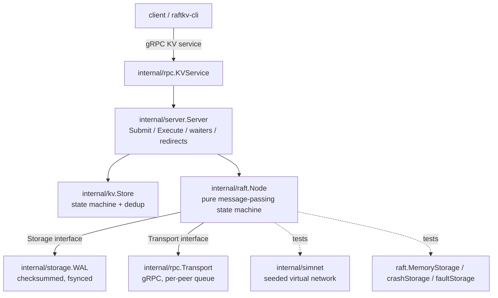

# RaftKV: Project Handoff Document

Handoff written 2026-11-01 at the end of Phase 5. Paste this whole document into a new Claude conversation, then attach the source files listed in section 15. It is a transfer of context, not a substitute for the source code.

Everything here was verified in the conversation unless it is marked **[unverified]** or **[not recoverable]**. Where this document and the repository disagree, the repository wins.

---

## 1. Master Project Summary

**RaftKV** is a linearizable key-value store built on a from-scratch implementation of the Raft consensus algorithm in Go, plus a deterministic chaos-testing harness that proves it stays correct under failures.

- **Owner:** Ritvik, college sophomore (ECE). Prior SWE internships at Visa (summer 2026), Doppler (summer 2025) and Astraea. Proficient in C and Python; Go is new for this project.
- **Purpose:** a GitHub-first portfolio project for Summer 2027 SWE internship applications. He may later put it on his resume.
- **The selling point is not "implements Raft"** but "demonstrably correct under failure". The Raft core is independent of the network and disk, so whole clusters run single-threaded on a seeded simulated network, every failure replays from its seed, and recorded client histories are checked for linearizability with Porcupine.
- **Repo:** `github.com/ritvik-devireddy/RaftKV` (local: `C:\SWEProjects\RaftKV`). Go module path (lowercase): `github.com/ritvik-devireddy/raftkv`.
- **Stage:** Phases 0 to 5 are done and pushed (latest commit `3d497bf` on `main`). Phase 6 (PreVote, snapshots and log compaction, benchmarks, diagram, polish) has not started.

## 2. Project Goals and Requirements

- A cluster of 3 or 5 nodes replicating a KV store (Get / Put / Delete / CompareAndSwap) with linearizable semantics and exactly-once writes.
- Survives: crashes at any point (including mid-write), message loss, partitions, restarts from disk.
- Provable: deterministic seeded tests, mutation-tested, Porcupine-verified histories.
- Usable: gRPC API, a CLI, a server binary, Docker Compose cluster.
- Honest: every limitation is documented; resume claims must match what exists.
- Standard for all code: correct, well tested, explainable in an interview. Quality over feature count.
- Non-goals (documented in `docs/design.md`): membership changes, TLS/auth, multi-region, sharding, performance records.

## 3. Complete System Architecture



- **Language / tooling:** Go (go.mod says `go 1.26.0`; his machine has Go 1.27.x). gRPC v1.85.0, protobuf v1.36.x, Porcupine v1.3.1 (`github.com/anishathalye/porcupine`). protoc 36.2.
- **No database.** State is the Raft log in the WAL; the KV map is rebuilt by re-applying the committed log.
- **Security:** none (insecure gRPC credentials). Stated as a non-goal.
- **Deployment:** `Dockerfile` (`golang:1.26` builder), `docker-compose.yml` for a 3-node cluster **[`docker compose up --build` never verified; Docker not confirmed installed]**.
- **CI:** `.github/workflows/ci.yml` on push to `main` and PRs: `gofmt` check, `go vet`, `go build`, `go test -race -count=1 ./...` on `ubuntu-latest`, Go version from go.mod.

### Data flow of a write
1. Client sends Put with `(ClientID, Seq)` to any node via gRPC (`KVService`).
2. `Server.Submit` encodes the command (`kv.Command.Encode`) and calls `Node.Propose`. A non-leader returns `NotLeaderError{Leader}`; `KVService` turns it into redirect info.
3. The leader appends to its log (**storage first, memory second**), sends AppendEntries to followers via `Transport`.
4. Followers persist, then reply. When a majority has the entry and it is from the leader's current term, `advanceCommit` commits it.
5. `Node.applyCommitted` calls `Config.Apply` for each committed entry in order. `Server.apply` decodes, runs `kv.Store.Apply` (dedup by `(ClientID, Seq)`), and completes the waiter registered at that log index (only if the applied entry's term matches the proposal term).
6. The reply goes back to the client. Reads take the same path (read through the log), which is why they are linearizable.

## 4. Codebase Structure and File Responsibilities

Verified file list (non-generated, ~5,900 lines):

```
.github/workflows/ci.yml        CI
.dockerignore .gitattributes .gitignore LICENSE
Dockerfile docker-compose.yml
README.md
api/raftkv.proto                gRPC/protobuf definitions
api/raftkvpb/                   GENERATED (raftkv.pb.go, raftkv_grpc.pb.go); exists only on his machine/repo, regenerate with scripts/gen-proto.ps1
bench/doc.go                    stub for Phase 6 benchmarks
cmd/raftkv-server/main.go       server binary
cmd/raftkv-cli/main.go          CLI client
docs/design.md                  design notes (Durability, Server layer, Linearizability checking, testing strategy, bugs table, open questions)
docs/STATUS.md                  older handoff (Phase 5 section partly superseded by this file)
docs/HANDOFF.md                 this file
internal/raft/
    types.go                    NodeID, Term, Index, Role, LogEntry, Config, RPC payloads, Message, Transport, Status
    node.go                     574 lines: the Raft core
    storage.go                  Storage interface, PersistentState, MemoryStorage
    cluster_test.go             cluster harness + election tests
    election_test.go            election tests
    replication_test.go         replication tests + propose/convergence helpers
    crash_test.go               crashStorage, crash/restart harness, crash tests
    durability_order_test.go    TestRepliesNeverOutrunTheDisk
    node_test.go                small unit tests
internal/storage/
    wal.go                      the WAL (implements raft.Storage)
    wal_test.go                 480 lines of WAL tests
    doc.go
internal/simnet/simnet.go       deterministic simulated network (+ simnet_test.go)
internal/kv/
    store.go                    state machine and dedup
    codec.go                    Command binary codec
    store_test.go codec_test.go
internal/server/
    server.go                   Server joining Node + Store
    server_test.go
internal/rpc/
    convert.go                  raft.Message <-> protobuf
    transport.go                gRPC Transport implementation
    services.go                 RaftService and KVService
    convert_test.go
internal/client/client.go       leader-finding client
internal/chaos/                 Phase 5
    faultstore.go               faultStorage (panics with errCrash at the Nth storage op)
    world.go                    World, Options, Op, clients, fault injection
    world_test.go
test/linearizability/           Phase 5
    model.go                    Porcupine model and Operations()
    chaos_test.go               the chaos tests
    doc.go
scripts/gen-proto.ps1, gen-proto.sh
```

### internal/raft (stdlib only)
- `types.go`: `NodeID int`, `Term uint64`, `Index uint64`, `Role` (Follower/Candidate/Leader), `NoLeader`, `NoVote`. `LogEntry{Index, Term, Command []byte}` with `IsNoOp()` meaning `len(Command)==0`. `Config{ID, Peers (includes self), ElectionTickMin, ElectionTickMax, HeartbeatTick, Seed, Apply func(LogEntry)}` with defaults 10 / 2x min / 2. `RequestVoteArgs{Term, CandidateID, LastLogIndex, LastLogTerm}`, `RequestVoteReply{Term, VoteGranted}`, `AppendEntriesArgs/Reply` (reply has the extra `MatchIndex` and `LastLogIndex` fields). `Message{From, To, Payload any}` (payloads are the RPC types by value). `Transport interface{ Send(Message) }` is best-effort and called under the node lock, so it must not block or call back. `Status{ID, Role, Term, Leader, CommitIndex, LastApplied, LastLogIndex}`.
- `node.go` public API: `NewNode(cfg, storage, transport) (*Node, error)` (loads persistent state, checks the stored log is contiguous, always starts as Follower), `Tick()`, `Step(Message)`, `Propose(command) (Index, Term, ok)`, `Status()`. No goroutines, no real clock.
- `node.go` internals: `startElection` (increments term, votes self, `saveHardState`, resets timer, sends RequestVote; a single-node cluster wins immediately), `handleRequestVote` (any higher-term message makes the node `stepDown` to that term; grant requires same term, vote free or already for this candidate, and `candidateUpToDate`; persists the vote before replying; granting resets `electionElapsed`), `handleRequestVoteReply`, `becomeLeader` (init nextIndex/matchIndex; appends a no-op), `stepDown`, `candidateUpToDate` (compare last term, then last index), `replicateAll`, `sendAppendEntries`, `handleAppendEntriesReply`, `advanceCommit`, `handleAppendEntries`, `applyCommitted`, `majority()`, `appendLocal`, `lastLog`, `termAt`, `resetElectionTimer`, `send`, `saveHardState`, `must(err, what)`.
- `Tick()`: a leader sends AppendEntries every `HeartbeatTick`; everyone else counts `electionElapsed` and starts an election at the randomized `electionTimeout`.
- `storage.go`: `PersistentState{CurrentTerm, VotedFor, Log}`. `Storage` interface: `SaveHardState(term, votedFor)`, `Append([]LogEntry)` (indexes must continue the log with no gap), `TruncateFrom(index)` (deletes index and after), `Load() (PersistentState, error)`; each must be durable before returning. `MemoryStorage` additionally has `Save(PersistentState)` (a test seeding helper, not in the interface).

### internal/storage/wal.go
`Open(dir, Options) (*WAL, error)`, `Close`, `Path`, the four Storage methods; internals `write`, `frame`, `replay(data) (PersistentState, int, error)`, `apply(st, body)`, `allZero`, `syncDir`. `Options{NoSync}` exists for benchmarks ONLY.

### internal/simnet
`New(Config{MinDelay, MaxDelay, DropRate, Seed, ...})`, `Register(id, Handler)`, `Send`, `Partition(groups ...[]int)`, `Heal`, `SetDropRate`, `Step`, `RunUntil`, `Now`, `Stats`. Virtual clock plus event heap; same seed gives the same schedule.

### internal/kv
`Command{Op, Key, Value, Expected, ClientID, Seq}`, `Op` = OpGet/OpPut/OpDelete/OpCAS, `Result{Value, OK}`, `Store` with `Apply(cmd) Result`, `Snapshot() map[string]string` (data only, not sessions). Encoding never produces an empty slice (empty means no-op in Raft).

### internal/server
`New(cfg, storage, transport) (*Server, error)`, `Submit`, `Execute`, `Step`, `Tick`, `Status`, `Run(ctx, interval)`, `Data()`. `Pending{Done(), Result()}`, `NotLeaderError{Leader}`, `ErrLostLeadership`.

### internal/rpc and internal/client
See section 3. `NewTransport(self, addrs, logger)`; per-peer bounded queue plus sender goroutine; drops when full. `RaftService.Step`, `KVService` (Get/Put/Delete/CompareAndSwap; maps errors to redirect, Unavailable, DeadlineExceeded). `client.New(addrs)` with `Get`, `Put`, `Delete`, `CompareAndSwap`, leader finding, backoff.

### internal/chaos and test/linearizability
See section 5 (Phase 5).

## 5. Implemented Features and Internal Logic

All of the following are **fully implemented** unless noted.

### Phase 0: scaffolding
Repo layout, CI, simnet, KV state machine with dedup, README skeleton.

### Phase 1 and 2: Raft election and replication
- Randomized election timeouts per node (seeded), heartbeats, election restriction (5.4.1), log matching, Figure 8 rule (leader commits by counting replicas only for current-term entries), no-op appended on election.
- Followers never truncate a matching entry (a delayed AppendEntries must not shorten a log). Follower commit index is capped at the last entry the message verified.
- `AppendEntriesReply` carries `MatchIndex` and `LastLogIndex`, so duplicated or reordered replies cannot corrupt `matchIndex` and a leader can back up `nextIndex` in one step.

### Phase 3: durability
- **Persist before reply**, in this order: storage first, memory second. Any storage error panics the node via `must`.
- **WAL format:** record = `crc32c(4, LE) | bodyLen(4, LE) | type + payload`, CRC (Castagnoli) over length plus body. Record types: hard state, entry, truncate. fsync before returning; `syncDir` for directory entries. A failed write or sync poisons the WAL.
- **Recovery rules** (`replay`): a short or past-EOF record is a torn tail and is cut. CRC mismatch is torn only if all bytes after it are zero, else `ErrCorrupt`. Zero length is torn only if the rest of the file is zero. `bodyLen > 64MiB` is corrupt. A semantically impossible record is `ErrCorrupt`.
- **Known limitation:** damage to a middle record's length field that looks like a record running off the end is indistinguishable from a torn tail and is treated as one.
- **Crash injection:** `crashStorage` / `faultStorage` panic with `errCrash` at the Nth storage operation, either before the operation reaches the disk or just after it does. Nodes restart from storage alone, with a new seed per life.

### Phase 4: server, gRPC, CLI, Docker
- `Server` waiters keyed by log index plus proposal term. In `apply`: if a waiter exists at `e.Index`, it receives the result only when `w.term == e.Term && !e.IsNoOp()`, else `ErrLostLeadership`. A `recent` results map covers results applied before `Submit` registers its waiter (single-node commit happens inside `Propose`).
- Exactly-once writes: dedup by `(ClientID, Seq)` in the replicated state machine, caching only the last result per client. **Invariant: one operation in flight per client.**
- Wire protocol: one fire-and-forget `Raft.Step(RaftMessage)` RPC with a `oneof` payload (the core treats a reply as an independent message). Non-blocking per-peer bounded queue that drops when full.
- Client reuses `(ClientID, Seq)` across retries and follows redirects.
- **Live demo verified** (3 nodes via `go run`, 4 PowerShell windows): put/get worked, killing the leader left reads and writes working, the restarted node logged `term=5 log_len=3` (recovered from its WAL) and rejoined as follower. The restarted node had campaigned through terms 6 and 7 and forced an extra election (the no-PreVote disruption).

### Phase 5: linearizability checking
- **`internal/chaos.World`** runs real `server.Server` nodes on simnet with `faultStorage`, 3 or 5 nodes, step-driven clients. Fault injection: drops, partitions (heal / isolate the current leader / random split), node crash and restart at arbitrary storage operations, abandoned requests.
- **Options** (defaults): `Seed`, `Nodes` 3, `Clients` 4, `Keys` 2, `DropRate` 0.1, `CrashRate` 0.003, `PartitionRate` 0.01, `AbandonRate` 0.03, `StaleReads`, `NoDedup`. Constants: `TickDuration` 10ms, `attemptTimeout` 100 ticks, `giveUp` 400 ticks. `Run(chaosTicks, settleTicks) []Op`. Chaos tests use `chaosTicks=1500`, `settleTicks=1500`.
- **Op mix:** Put 30, Get 30, Delete 15, CAS 25 over keys `k0..`; CAS `Expected` is mostly the last issued value so some CASes succeed.
- **`Op{Client, Cmd, Call, Return int64, Result, Done}`** in virtual nanoseconds. `Done=false` means the outcome is unknown (the client gave up or walked away after a successful Submit). With `AbandonRate` the client deliberately walks away to produce such operations (before this, almost none were produced).
- **Model (`test/linearizability/model.go`):** Porcupine model partitioned by key; state `keyState{exists, value}`. An unknown-outcome op gets `Return = math.MaxInt64` and `Output{Unknown: true}`; `Step` applies its effect and always accepts, because the op may be linearized last (hiding its effect) or at any time after it was called. `Operations(history) []porcupine.Operation`.
- **Tests (`chaos_test.go`):** `TestLinearizableUnderChaos` (env `RAFTKV_CHAOS_FIRST_SEED`, `RAFTKV_CHAOS_SEEDS`, default **200** seeds, alternating 3 and 5 nodes, 60s check budget; on a violation it writes `failure-seed-N.html` (git-ignored) and prints a replay command; asserts the run was not vacuous), `TestCheckerCatchesStaleReads`, `TestCheckerCatchesMissingDedup` (each runs up to 150 seeds and requires a violation), `TestModelOnHandWrittenHistories` (14 cases). In `chaos` package: `TestRunsAreDeterministic`, `TestFaultFreeRunCompletesEverything` (passes near-zero fault rates, e.g. `1e-9`), `TestChaosRunMakesProgress`.
- **Validation (done):** against the real Porcupine v1.3.1 on Ritvik's machine: 200 seeds linearizable under `-race`, 8.7s. Earlier, against a local stand-in checker in the container: stale reads caught at seed 1, no-dedup at seed 12; 9,045 ops over 15 seeds linearizable.

## 6. Development History and Technical Decisions

### Milestones and commits
- Phase 2 pushed `55c1ae8`. Phase 3 pushed `7843ff7` (CI green). Phase 4 pushed `88e9122`. Docs commit `2f88d87`. Phase 5 pushed as three commits ending at `3d497bf`: `c939b60` (chaos world), `44f0316` (Porcupine model and tests, plus go.mod/go.sum), `3d497bf` (docs). **[Phase 0 and 1 commit hashes not recoverable.]**
- CI was green on `88e9122`. **[CI status on `3d497bf` not yet confirmed.]**

### Bugs found and fixed (with how)
1. **No-op waiter bug (real product bug).** `server.apply` returned early for no-op entries, so a client whose leader was deposed, with its index taken over by the new leader's no-op, waited forever. Found by `TestDeposedLeadersPendingCommandFails`; fixed in `apply` (see section 5).
2. **Phantom commands in the crash harness.** A node crashing mid-`Propose` left `proposed[cmd]` unset or deleted. Fixed: `proposeTo` sets `proposed` first and deletes it only if rejected without a crash.
3. **Test-time explosion.** Raft package took 310s under `-race`. Fixed with a cheap per-tick `checkDurable` (summary compare; full compare every 25th call) and 20 seeds.
4. **Surviving mutants** led to new tests: `TestRepliesNeverOutrunTheDisk` and `TestZeroLengthRecordFollowedByDataIsCorrupt`.
5. **WAL test artifacts:** nil vs empty log in `DeepEqual` (added a `same()` helper); zero-fill expectations (compare by bytes with `expectedFor`).
6. **Slow storage tests on Windows** (137s then 66s) because of many small files and antivirus; fixed to ~6s by avoiding that pattern.
7. **Chaos harness produced almost no unknown outcomes**; added `AbandonRate` and raised `giveUp` to 400.
8. **`device_commit_files` silently not landing** several times; always verify by sha256 and re-send with `force: true`.

### Mutation testing (production code, scratch copy)
Caught by the chaos test within a few seeds: commit without majority, vote ignoring log recency, server waiter ignoring term, dedup returning the wrong result. **The Figure 8 mutant (commit an old-term entry by counting replicas) survived 3,000 chaos seeds** and is caught only by the targeted unit test `TestLeaderCommitsOnlyCurrentTermEntriesByCounting`. This is documented in `docs/design.md`. Lesson: chaos finds unknown bugs; targeted tests pin known ones.

### Decisions that should not be reversed without good reason
- Raft core is a deterministic message-passing state machine over logical ticks (enables seeded replay).
- Persist before reply; storage first, memory second; storage failure panics.
- Reads go through the log (simple and linearizable).
- Unknown-outcome ops are recorded with infinite return time, never "did not happen".
- One op in flight per client; dedup caches only the last result.
- Do not backdate commits. Do not make filler commits.
- Do not use `Options{NoSync}` outside benchmarks.

### Rejected or deferred
Lease reads / ReadIndex (deferred), membership changes (non-goal), TLS (non-goal, optional later), request/response RPC pairs for Raft (rejected for the single `Step` RPC).

## 7. Current Working State

- **Works and is tested:** everything in Phases 0 to 5.
- **Last verified test run (Ritvik's machine, after `go mod tidy`):** `gofmt -l .` empty, `go vet ./...` clean, `go test -race -count=1 ./...` all `ok`: chaos 2.4s, kv 1.4s, raft 44.5s, rpc 3.0s, server 1.6s, simnet 1.3s, storage 5.6s, test/linearizability 8.7s. `api/raftkvpb`, `bench`, `cmd/*`, `internal/client` have no test files.
- **Pending results:** (a) the 2000-seed soak run (command in section 9), (b) GitHub Actions status on `3d497bf`. If the soak is ok, add "2,000 seeds linearizable" to the README.
- **Incomplete:** Phase 6.
- **Broken:** nothing known.
- **Unverified:** `docker compose up --build`.

## 8. Tests, Bugs, and Known Issues

### Test inventory
- `internal/raft`: `TestClusterElectsALeader` (3 and 5 nodes, 200 seeds), `TestElectionSafetyWithMessageLoss`, `TestElectionSafetyUnderRandomPartitions`, replication tests (Log Matching, State Machine Safety, no phantom commands, checked after every event via `observe`), `TestSafetyUnderRandomCrashes` (3 and 5 nodes x 20 seeds), `TestSafetyUnderCrashesAndPartitions` (20 seeds), `TestCrashAtEveryStorageOperation` (3 seeds x 3 nodes x every op x applied/not applied), `TestRepliesNeverOutrunTheDisk`.
- `internal/storage`: model-based vs `MemoryStorage`, cut at every byte offset via `replay`, bit flips, torn batches, poison on I/O failure, end-to-end node restart on a real WAL, `TestZeroLengthRecordFollowedByDataIsCorrupt`.
- `internal/server`: `TestPutThenGetThroughTheLeader`, `TestFollowerRedirectsToTheLeader`, `TestRetriedCommandRunsOnce`, `TestDeposedLeadersPendingCommandFails`, `TestAcknowledgedCommandsSurviveChaos`, `TestStoreIsRebuiltFromTheWALAfterRestart`.
- `internal/simnet`: determinism, drop rate, partition and heal, in-flight drops.
- `internal/rpc`: protobuf round trip. `internal/kv`: store and codec tests.
- Test helpers (package `raft`): `cluster`, `newCluster(t, size, seed, simnet.Config)`, `baseNet` (1 to 5ms delays), `c.run(ticks)`, `c.statuses()`, `c.requireStable() Status`, `c.nodeConfig(id)`, `c.observe()`, `crashStorage` (`armIn`, `armAt`, `disarm`, `summary`), `c.guard`, `c.crash`, `c.restart`, `c.maybeCrash`, `c.logOf`, `c.checkDurable`, `c.requireAllUp`, `c.proposeTo`, `c.propose`, `c.onApply`, `c.checkLogMatching`, `c.requireConverged`. Fields: `crashRate`, `down[]` (ticks until restart), `storages[]`, `nodes[]`, `net`, `leaders`, `applied`, `global`.

### Known issues and limitations
- **No PreVote** (Raft thesis section 9.6). Mechanism: `handleRequestVote` calls `stepDown` on any higher-term request, so a node that was isolated (or restarted) and climbed its term disrupts a stable leader when it reconnects. Observed live (terms 6 and 7 after restarting node 0). Documented in `docs/design.md`.
- No snapshots or log compaction: the log grows without bound, restart replays the whole log, and the `kv` sessions map grows without bound (`TODO(snapshots)` in `store.go`).
- Reads go through the log (slow).
- Static membership. Insecure gRPC.
- WAL length-field corner case (section 5).
- A restarted single node must win an election before it re-learns the commit index and re-applies the log.

## 9. Development Environment and Commands

- **User machine:** Windows 11, PowerShell, `C:\SWEProjects\RaftKV`, Go 1.27.x, protoc 36.2 (installed via `winget install protobuf`), a C compiler (needed for `-race`), plugins `protoc-gen-go` and `protoc-gen-go-grpc` via `go install ...@latest`.
- **Claude's workspace:** cloud Linux container, Go 1.24.x, **cannot download Go modules and has no protoc**; the device shell is a Linux VM with no Go and a blocked proxy. So Claude can only compile and test code with no third-party imports; code using gRPC, protobuf, or Porcupine was type-checked against stub modules and then compiled by Ritvik. The container's `go.mod`, `go.sum` and `api/raftkvpb` are out of date relative to his machine, so **never deliver them over his**.
- **Delivery procedure (Claude Code environment only):** write in `/mnt/user-data/outputs/RaftKV`, send with `device_commit_files` to `C:\SWEProjects\RaftKV\...`, wait a few seconds, verify with `sha256sum` through `device_bash` (`$HOME/mnt/RaftKV`); if it did not land, re-send with `force: true`.
- **Commands (PowerShell, from `C:\SWEProjects\RaftKV`):**
  ```
  gofmt -l .
  go vet ./...
  go build ./...
  go test -race -count=1 ./...
  go test ./test/linearizability -v
  $env:RAFTKV_CHAOS_SEEDS=2000; go test ./test/linearizability -run TestLinearizableUnderChaos -timeout 1h
  $env:RAFTKV_CHAOS_FIRST_SEED=<n>; $env:RAFTKV_CHAOS_SEEDS=1; go test ./test/linearizability -run TestLinearizableUnderChaos -v   # replay a failing seed
  scripts\gen-proto.ps1                              # regenerate protobuf
  ```
- **Run a cluster:** see the README "Run a cluster" section (three `go run ./cmd/raftkv-server ...` processes plus `raftkv-cli`; or `docker compose up --build` **[unverified]**).
- **Env vars:** `RAFTKV_CHAOS_SEEDS`, `RAFTKV_CHAOS_FIRST_SEED`. No secrets in the repo.
- **Git:** branch `main`. Workflow: Ritvik runs `git add`, `git commit`, `git push`. Claude appends its co-author trailer only when Claude itself creates a commit (it normally does not).
- `.gitignore` covers binaries, `/data/`, `*.wal`, `*.snap`, profiles, `/test/linearizability/*.html`.

## 10. My Development Preferences and Constraints

- **One paste-all PowerShell block, then one result to report.** Not single drip-fed steps. He explicitly complained: "can you give me the steps more effectively this is taking forever just to test". Tell him what a failure means.
- Concise answers; plain language; explain design choices briefly so he can explain them in interviews. He is open to a `node.go`/WAL walkthrough (offered, not taken up yet).
- **He commits and pushes; Claude writes code.** Small, descriptive commits; gradual over about a week of improvements; **never backdate**; no filler commits to pad the contribution graph.
- Claude should not mention internal tool names to him; say "your folder", "your computer".
- Docs must stay accurate: do not claim Phase 6 items before they exist; update `README.md`, `docs/design.md` and `docs/STATUS.md` after each phase.
- Quality bar before delivering code: `gofmt` clean, `go vet`, `go test -race`, **plus mutation testing** (inject a deliberate bug in a scratch copy and confirm a test fails; a surviving mutant is a missing test unless it is semantically equivalent).
- He prefers keeping the work in one chat if it works; he asked whether to move to a Project chat. I advised staying in the original chat (it has the working delivery loop). If he moves, this document plus the attached source files is the handoff.

## 11. Remaining Roadmap

Do not expand the scope beyond this.

### Immediate (Phase 6, in order)
1. **PreVote.** Why: removes the disruption in section 8. Files: `internal/raft/types.go` (PreVote args/reply, Message payload), `internal/raft/node.go` (a pre-candidate phase that does not increment the term or persist anything; a voter grants a pre-vote only if it has not heard from a leader within the minimum election timeout and the candidate's log is up to date; the real election starts only after a majority of pre-votes), `internal/rpc/convert.go` and `api/raftkv.proto` (new messages; **regenerate protobuf on Ritvik's machine**), tests in `internal/raft`. Verify: a new deterministic test reproduces the disruption and **fails on current code first**; then passes with PreVote; whole raft suite, `TestSafety*`, crash tests, and `test/linearizability` still pass; mutation-test the new code (for example grant pre-votes unconditionally, or let a pre-candidate bump its term). Update `docs/design.md`.
2. **Snapshots and log compaction** (about 2 days, the riskiest part). Why: unbounded log, restart replays everything, sessions unbounded. Needs: a snapshot of `kv.Store` data AND sessions, snapshot save/load in `Storage` (and `MemoryStorage`, `crashStorage`, `faultStorage`, `WAL`), log-index offset handling throughout `node.go` (`termAt`, `lastLog`, `handleAppendEntries`, the replication path), an `InstallSnapshot` message for slow followers (types.go, proto, convert.go), WAL compaction/rotation that preserves torn-write recovery, and server wiring. Verify: extend `TestCrashAtEveryStorageOperation` to the new ops, extend the chaos world to trigger compaction, Porcupine still passes (thousands of seeds), mutation tests on the compaction boundary.
3. **Benchmarks** (`bench/`): throughput and p50/p99 latency for 1/3/5 nodes, time to elect after killing the leader. State the hardware and what bounded each number; use `NoSync` only for micro-benchmarks and report real fsync numbers honestly.
4. **README architecture diagram, demo GIF or recording, README polish.**

### Longer term / optional
ReadIndex or lease reads, TLS, session expiry, verifying `docker compose up --build`, a `node.go`/WAL interview walkthrough.

## 12. Exact Current Stopping Point

- Phase 5 is complete, pushed (`3d497bf`), and passes with real Porcupine locally.
- Ritvik was told to (a) press Enter on `git status --short` (it should print nothing), (b) run the 2000-seed soak and report the output, (c) check Actions on `3d497bf`. He has not reported (a) to (c) yet.
- He then asked about moving to a Project chat and requested this handoff. I recommended staying in the original chat; the decision is his.
- No PreVote code has been written yet.

## 13. Immediate Next Implementation Steps

1. Ask for the soak-run output and the Actions status for `3d497bf`. If the soak is ok, update the README claim; if CI is red, fix that first.
2. Read in full: `internal/raft/node.go`, `types.go`, `storage.go`, `cluster_test.go`, `crash_test.go`, `replication_test.go`, `api/raftkv.proto`, `internal/rpc/convert.go`.
3. Write the PreVote reproducing test first, show that it fails on the current code, then implement PreVote.
4. Give one paste-all block: `gofmt -l .`, `go vet ./...`, `go test -race -count=1 ./...` (and the protoc regeneration step if the proto changed).
5. Then suggest small commits (test, implementation, docs), and move to snapshots.

## 14. Critical Things the Next Claude Must Remember

- **Invariants:** persist before reply; `LogEntry.IsNoOp()` is `len(Command)==0`, so a real command must never be empty; the leader commits only current-term entries by counting (Figure 8) and appends a no-op on election; followers never truncate a matching entry; `Apply` and `Transport.Send` run under the node lock and must not call back into the node; one op in flight per client; unknown ops are never "did not happen".
- Hidden dependencies: `crashStorage` (raft tests) and `faultStorage` (chaos) are separate copies implementing the same interface; any new `Storage` method must be added to **MemoryStorage, WAL, crashStorage and faultStorage**, or tests will not compile or will not exercise crashes on it.
- Determinism: never use wall clocks or `math/rand` global state in `internal/raft`; use the seeded `rng`. Do not introduce goroutines into the core.
- Adding a new Raft message means updating `types.go`, `Node.Step`, `proto`, `convert.go`, and `convert_test.go`.
- Common mistakes already made: forgetting a waiter at no-op entries; tests that create thousands of files (slow on Windows); heavy per-tick full comparisons under `-race` (310s); delivering files that did not land (always verify by hash); overwriting his `go.mod`/`go.sum`/`api/raftkvpb`.
- Performance: raft package ~45s under `-race`; keep new tests proportionate (seed counts).
- Honest claims only on the resume and README.

## 15. Missing Information or Files Needed

- The actual source files (this document is not a substitute). Minimum for PreVote: `internal/raft/{node,types,storage}.go`, the three raft test files `cluster_test.go`, `crash_test.go`, `replication_test.go`, `api/raftkv.proto`, `internal/rpc/convert.go`, `docs/design.md`. For snapshots additionally: `internal/storage/wal.go`, `internal/kv/store.go`, `internal/server/server.go`, `internal/chaos/{world,faultstore}.go`.
- The soak-run output and Actions status for `3d497bf` (pending from Ritvik).
- **[Not recoverable from the conversation]:** commit hashes for Phases 0 and 1, exact earlier test timings, and the contents of the generated `api/raftkvpb` files (only on his machine/repo). The container-side copies of `go.mod`, `go.sum` and `api/raftkvpb` are stale.

## 16. INSTRUCTIONS FOR THE NEXT CLAUDE INSTANCE

You are taking over an active Go project. Read this section carefully.

- This document is the transferred project context. Treat everything not marked unverified as the established baseline; do not re-derive or redo completed phases (0 to 5).
- Continue from the stopping point in section 12 and the plan in sections 11 and 13. Do not restart, and do not repeat completed work.
- Keep the existing architecture, conventions, naming, and test style. No unnecessary rewrites, refactors, or scope changes.
- Respect Ritvik's preferences (section 10): one paste-all PowerShell block per step, concise, explain design choices briefly, small descriptive commits, never backdate, no filler commits.
- **Inspect the real repository or ask for the files in section 15 before writing code.** Signatures here are accurate as of `3d497bf`, but the handoff is not a substitute for source. Ask for missing files only when genuinely necessary.
- Verify uncertain details rather than inventing them. If a detail is marked unverified or not recoverable, say so and ask.
- If you cannot download Go modules or run protoc in your environment, say so and have Ritvik run those steps. Never overwrite his `go.mod`, `go.sum`, or `api/raftkvpb`.
- For every new safety-relevant feature: write the test that fails without it first, run `gofmt`, `vet`, `-race`, run the chaos and linearizability suites, and mutation-test your own change.
- Update `README.md`, `docs/design.md` and `docs/STATUS.md` after each phase, and only claim what exists.
- Start by asking for the soak output and CI status, then begin PreVote as in section 13.
