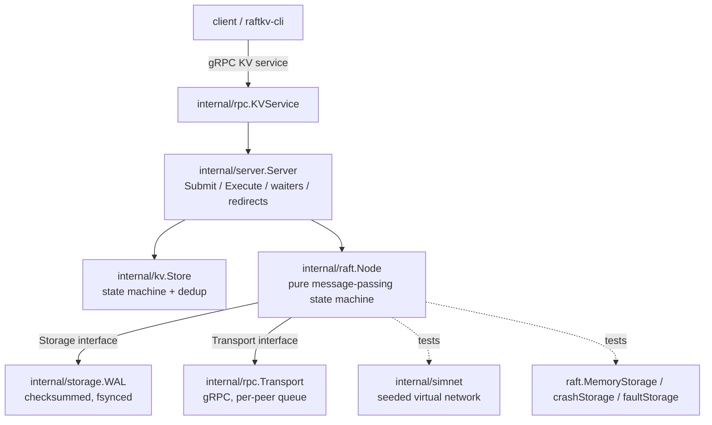

# RaftKV: Project Handoff Document

Handoff last updated 2026-11-02, after Phase 5, PreVote, the README/CI/soak work and the CLAUDE.md addition. Use it as the first message of a new chat (or let a Claude Code session read it from the repo), and give the new Claude the source files listed in section 15. It is a transfer of context, not a substitute for the source code.

Everything here was verified in the conversation unless it is marked **[unverified]** or **[not recoverable]**. Where this document and the repository disagree, the repository wins.

---

## 1. Master Project Summary

**RaftKV** is a linearizable key-value store built on a from-scratch implementation of the Raft consensus algorithm in Go, plus a deterministic chaos-testing harness that proves it stays correct under failures.

- **Owner:** Ritvik, college sophomore (ECE). Prior SWE internships at Visa (summer 2026), Doppler (summer 2025) and Astraea. Proficient in C and Python; Go is new for this project.
- **Purpose:** a GitHub-first portfolio project for Summer 2027 SWE internship applications. He may later put it on his resume.
- **The selling point is not "implements Raft"** but "demonstrably correct under failure". The Raft core is independent of the network and disk, so whole clusters run single-threaded on a seeded simulated network, every failure replays from its seed, and recorded client histories are checked for linearizability with Porcupine.
- **Repo:** `github.com/ritvik-devireddy/RaftKV` (local: `C:\SWEProjects\RaftKV`). Go module path (lowercase): `github.com/ritvik-devireddy/raftkv`.
- **Stage:** Phases 0 to 5 and PreVote are done and pushed (PreVote commits `eb92d26` and `83ee1a8`; `6074ca9` before them added the soak result and an earlier handoff). Since then Claude also wrote, **not confirmed committed or pushed as of this handoff**: the restructured README, the architecture section of `docs/design.md`, `.github/workflows/soak.yml`, `scripts/demo.ps1` and `CLAUDE.md` (run `git status` and `git log` to see what is in). Remaining: snapshots and log compaction (design proposed, awaiting approval), benchmarks, CheckQuorum, a chaos replay visualizer, a demo GIF.

## 2. Project Goals and Requirements

- A cluster of 3 or 5 nodes replicating a KV store (Get / Put / Delete / CompareAndSwap) with linearizable semantics and exactly-once writes.
- Survives: crashes at any point (including mid-write), message loss, partitions, restarts from disk.
- Provable: deterministic seeded tests, mutation-tested, Porcupine-verified histories.
- Usable: gRPC API, a CLI, a server binary, Docker Compose cluster.
- Honest: every limitation is documented; resume claims must match what exists.
- Standard for all code: correct, well tested, explainable in an interview. Quality over feature count.
- Non-goals (documented in `docs/design.md`): membership changes, TLS/auth, multi-region, sharding, performance records.

## 3. Complete System Architecture



- **Language / tooling:** Go (go.mod says `go 1.26.0`; his machine has Go 1.27.x). gRPC v1.85.0, protobuf v1.36.x, Porcupine v1.3.1 (`github.com/anishathalye/porcupine`). protoc 36.2.
- **No database.** State is the Raft log in the WAL; the KV map is rebuilt by re-applying the committed log.
- **Security:** none (insecure gRPC credentials). Stated as a non-goal.
- **Deployment:** `Dockerfile` (`golang:1.26` builder), `docker-compose.yml` for a 3-node cluster **[`docker compose up --build` never verified; Docker not confirmed installed]**.
- **CI:** `.github/workflows/ci.yml` on push to `main` and PRs: `gofmt` check, `go vet`, `go build`, `go test -race -count=1 ./...` on `ubuntu-latest`, Go version from go.mod.

### Data flow of a write
1. Client sends Put with `(ClientID, Seq)` to any node via gRPC (`KVService`).
2. `Server.Submit` encodes the command (`kv.Command.Encode`) and calls `Node.Propose`. A non-leader returns `NotLeaderError{Leader}`; `KVService` turns it into redirect info.
3. The leader appends to its log (**storage first, memory second**), sends AppendEntries to followers via `Transport`.
4. Followers persist, then reply. When a majority has the entry and it is from the leader's current term, `advanceCommit` commits it.
5. `Node.applyCommitted` calls `Config.Apply` for each committed entry in order. `Server.apply` decodes, runs `kv.Store.Apply` (dedup by `(ClientID, Seq)`), and completes the waiter registered at that log index (only if the applied entry's term matches the proposal term).
6. The reply goes back to the client. Reads take the same path (read through the log), which is why they are linearizable.

## 4. Codebase Structure and File Responsibilities

Verified file list (non-generated, ~5,900 lines):

```
.github/workflows/ci.yml        CI (gofmt, vet, build, test -race)
.github/workflows/soak.yml      nightly chaos soak: 50,000 fresh seeds (first seed = run number x 1,000,000); uploads failing histories; also runnable by hand
.dockerignore .gitattributes .gitignore LICENSE
Dockerfile docker-compose.yml
README.md                       restructured around a "what has been verified" table, mutation table, bugs found, 2 mermaid diagrams, limitations, roadmap
CLAUDE.md                       working notes Claude sessions read automatically (commands, invariants, how to work)
api/raftkv.proto                gRPC/protobuf definitions
api/raftkvpb/                   GENERATED (raftkv.pb.go, raftkv_grpc.pb.go); exists only on his machine/repo, regenerate with scripts/gen-proto.ps1
bench/doc.go                    stub for Phase 6 benchmarks
cmd/raftkv-server/main.go       server binary
cmd/raftkv-cli/main.go          CLI client
docs/design.md                  design notes (Durability, Server layer, Linearizability checking, testing strategy, bugs table, open questions)
docs/STATUS.md                  older handoff (Phase 5 section partly superseded by this file)
docs/HANDOFF.md                 this file
internal/raft/
    types.go                    NodeID, Term, Index, Role, LogEntry, Config, RPC payloads, Message, Transport, Status
    node.go                     574 lines: the Raft core
    storage.go                  Storage interface, PersistentState, MemoryStorage
    cluster_test.go             cluster harness + election tests
    election_test.go            election tests
    replication_test.go         replication tests + propose/convergence helpers
    crash_test.go               crashStorage, crash/restart harness, crash tests
    durability_order_test.go    TestRepliesNeverOutrunTheDisk
    node_test.go                small unit tests
    prevote_test.go             PreVote tests (reproducing test, grant rules, changes-nothing, stale replies, spacing)
internal/storage/
    wal.go                      the WAL (implements raft.Storage)
    wal_test.go                 480 lines of WAL tests
    doc.go
internal/simnet/simnet.go       deterministic simulated network (+ simnet_test.go)
internal/kv/
    store.go                    state machine and dedup
    codec.go                    Command binary codec
    store_test.go codec_test.go
internal/server/
    server.go                   Server joining Node + Store
    server_test.go
internal/rpc/
    convert.go                  raft.Message <-> protobuf
    transport.go                gRPC Transport implementation
    services.go                 RaftService and KVService
    convert_test.go
internal/client/client.go       leader-finding client
internal/chaos/                 Phase 5
    faultstore.go               faultStorage (panics with errCrash at the Nth storage op)
    world.go                    World, Options, Op, clients, fault injection
    world_test.go
test/linearizability/           Phase 5
    model.go                    Porcupine model and Operations()
    chaos_test.go               the chaos tests
    doc.go
scripts/gen-proto.ps1, gen-proto.sh
scripts/demo.ps1                starts a local 3-node cluster in 3 windows (-Fresh deletes ./data first) [written but never run]
```

### internal/raft (stdlib only)
- `types.go`: `NodeID int`, `Term uint64`, `Index uint64`, `Role` (Follower/Candidate/Leader), `NoLeader`, `NoVote`. `LogEntry{Index, Term, Command []byte}` with `IsNoOp()` meaning `len(Command)==0`. `Config{ID, Peers (includes self), ElectionTickMin, ElectionTickMax, HeartbeatTick, Seed, Apply func(LogEntry)}` with defaults 10 / 2x min / 2. `RequestVoteArgs{Term, CandidateID, LastLogIndex, LastLogTerm}`, `RequestVoteReply{Term, VoteGranted}`, `AppendEntriesArgs/Reply` (reply has the extra `MatchIndex` and `LastLogIndex` fields). `Message{From, To, Payload any}` (payloads are the RPC types by value). `Transport interface{ Send(Message) }` is best-effort and called under the node lock, so it must not block or call back. `Status{ID, Role, Term, Leader, CommitIndex, LastApplied, LastLogIndex}`.
- `node.go` public API: `NewNode(cfg, storage, transport) (*Node, error)` (loads persistent state, checks the stored log is contiguous, always starts as Follower), `Tick()`, `Step(Message)`, `Propose(command) (Index, Term, ok)`, `Status()`. No goroutines, no real clock.
- `node.go` internals: `startElection` (increments term, votes self, `saveHardState`, resets timer, sends RequestVote; a single-node cluster wins immediately), `handleRequestVote` (any higher-term message makes the node `stepDown` to that term; grant requires same term, vote free or already for this candidate, and `candidateUpToDate`; persists the vote before replying; granting resets `electionElapsed`), `handleRequestVoteReply`, `startPreVote` / `handlePreVote` / `handlePreVoteReply` (see Phase 6a in section 5), `logUpToDate(lastIndex, lastTerm)` (shared by `candidateUpToDate` and PreVote), `becomeLeader` (init nextIndex/matchIndex; appends a no-op), `stepDown`, `candidateUpToDate` (compare last term, then last index), `replicateAll`, `sendAppendEntries`, `handleAppendEntriesReply`, `advanceCommit`, `handleAppendEntries`, `applyCommitted`, `majority()`, `appendLocal`, `lastLog`, `termAt`, `resetElectionTimer`, `send`, `saveHardState`, `must(err, what)`.
- `Tick()`: a leader sends AppendEntries every `HeartbeatTick`; everyone else counts `electionElapsed` and, at the randomized `electionTimeout`, starts a **pre-vote** (not an election directly). New fields: `Node.preVotes map[NodeID]bool` (non-nil while pre-voting). New types in `types.go`: `PreVoteArgs{Term, CandidateID, LastLogIndex, LastLogTerm}` and `PreVoteReply{Term, PreVoteTerm, VoteGranted}`. Wire: `PreVoteRequest` / `PreVoteResponse` as `oneof` fields 7 and 8 of `RaftMessage`; `Role` is unchanged (a pre-candidate is a Follower).
- `storage.go`: `PersistentState{CurrentTerm, VotedFor, Log}`. `Storage` interface: `SaveHardState(term, votedFor)`, `Append([]LogEntry)` (indexes must continue the log with no gap), `TruncateFrom(index)` (deletes index and after), `Load() (PersistentState, error)`; each must be durable before returning. `MemoryStorage` additionally has `Save(PersistentState)` (a test seeding helper, not in the interface).

### internal/storage/wal.go
`Open(dir, Options) (*WAL, error)`, `Close`, `Path`, the four Storage methods; internals `write`, `frame`, `replay(data) (PersistentState, int, error)`, `apply(st, body)`, `allZero`, `syncDir`. `Options{NoSync}` exists for benchmarks ONLY.

### internal/simnet
`New(Config{MinDelay, MaxDelay, DropRate, Seed, ...})`, `Register(id, Handler)`, `Send`, `Partition(groups ...[]int)`, `Heal`, `SetDropRate`, `Step`, `RunUntil`, `Now`, `Stats`. Virtual clock plus event heap; same seed gives the same schedule.

### internal/kv
`Command{Op, Key, Value, Expected, ClientID, Seq}`, `Op` = OpGet/OpPut/OpDelete/OpCAS, `Result{Value, OK}`, `Store` with `Apply(cmd) Result`, `Snapshot() map[string]string` (data only, not sessions). Encoding never produces an empty slice (empty means no-op in Raft).

### internal/server
`New(cfg, storage, transport) (*Server, error)`, `Submit`, `Execute`, `Step`, `Tick`, `Status`, `Run(ctx, interval)`, `Data()`. `Pending{Done(), Result()}`, `NotLeaderError{Leader}`, `ErrLostLeadership`.

### internal/rpc and internal/client
See section 3. `NewTransport(self, addrs, logger)`; per-peer bounded queue plus sender goroutine; drops when full. `RaftService.Step`, `KVService` (Get/Put/Delete/CompareAndSwap; maps errors to redirect, Unavailable, DeadlineExceeded). `client.New(addrs)` with `Get`, `Put`, `Delete`, `CompareAndSwap`, leader finding, backoff.

### internal/chaos and test/linearizability
See section 5 (Phase 5).

## 5. Implemented Features and Internal Logic

All of the following are **fully implemented** unless noted.

### Phase 0: scaffolding
Repo layout, CI, simnet, KV state machine with dedup, README skeleton.

### Phase 1 and 2: Raft election and replication
- Randomized election timeouts per node (seeded), heartbeats, election restriction (5.4.1), log matching, Figure 8 rule (leader commits by counting replicas only for current-term entries), no-op appended on election.
- Followers never truncate a matching entry (a delayed AppendEntries must not shorten a log). Follower commit index is capped at the last entry the message verified.
- `AppendEntriesReply` carries `MatchIndex` and `LastLogIndex`, so duplicated or reordered replies cannot corrupt `matchIndex` and a leader can back up `nextIndex` in one step.

### Phase 3: durability
- **Persist before reply**, in this order: storage first, memory second. Any storage error panics the node via `must`.
- **WAL format:** record = `crc32c(4, LE) | bodyLen(4, LE) | type + payload`, CRC (Castagnoli) over length plus body. Record types: hard state, entry, truncate. fsync before returning; `syncDir` for directory entries. A failed write or sync poisons the WAL.
- **Recovery rules** (`replay`): a short or past-EOF record is a torn tail and is cut. CRC mismatch is torn only if all bytes after it are zero, else `ErrCorrupt`. Zero length is torn only if the rest of the file is zero. `bodyLen > 64MiB` is corrupt. A semantically impossible record is `ErrCorrupt`.
- **Known limitation:** damage to a middle record's length field that looks like a record running off the end is indistinguishable from a torn tail and is treated as one.
- **Crash injection:** `crashStorage` / `faultStorage` panic with `errCrash` at the Nth storage operation, either before the operation reaches the disk or just after it does. Nodes restart from storage alone, with a new seed per life.

### Phase 4: server, gRPC, CLI, Docker
- `Server` waiters keyed by log index plus proposal term. In `apply`: if a waiter exists at `e.Index`, it receives the result only when `w.term == e.Term && !e.IsNoOp()`, else `ErrLostLeadership`. A `recent` results map covers results applied before `Submit` registers its waiter (single-node commit happens inside `Propose`).
- Exactly-once writes: dedup by `(ClientID, Seq)` in the replicated state machine, caching only the last result per client. **Invariant: one operation in flight per client.**
- Wire protocol: one fire-and-forget `Raft.Step(RaftMessage)` RPC with a `oneof` payload (the core treats a reply as an independent message). Non-blocking per-peer bounded queue that drops when full.
- Client reuses `(ClientID, Seq)` across retries and follows redirects.
- **Live demo verified** (3 nodes via `go run`, 4 PowerShell windows): put/get worked, killing the leader left reads and writes working, the restarted node logged `term=5 log_len=3` (recovered from its WAL) and rejoined as follower. The restarted node had campaigned through terms 6 and 7 and forced an extra election (the no-PreVote disruption).

### Phase 5: linearizability checking
- **`internal/chaos.World`** runs real `server.Server` nodes on simnet with `faultStorage`, 3 or 5 nodes, step-driven clients. Fault injection: drops, partitions (heal / isolate the current leader / random split), node crash and restart at arbitrary storage operations, abandoned requests.
- **Options** (defaults): `Seed`, `Nodes` 3, `Clients` 4, `Keys` 2, `DropRate` 0.1, `CrashRate` 0.003, `PartitionRate` 0.01, `AbandonRate` 0.03, `StaleReads`, `NoDedup`. Constants: `TickDuration` 10ms, `attemptTimeout` 100 ticks, `giveUp` 400 ticks. `Run(chaosTicks, settleTicks) []Op`. Chaos tests use `chaosTicks=1500`, `settleTicks=1500`.
- **Op mix:** Put 30, Get 30, Delete 15, CAS 25 over keys `k0..`; CAS `Expected` is mostly the last issued value so some CASes succeed.
- **`Op{Client, Cmd, Call, Return int64, Result, Done}`** in virtual nanoseconds. `Done=false` means the outcome is unknown (the client gave up or walked away after a successful Submit). With `AbandonRate` the client deliberately walks away to produce such operations (before this, almost none were produced).
- **Model (`test/linearizability/model.go`):** Porcupine model partitioned by key; state `keyState{exists, value}`. An unknown-outcome op gets `Return = math.MaxInt64` and `Output{Unknown: true}`; `Step` applies its effect and always accepts, because the op may be linearized last (hiding its effect) or at any time after it was called. `Operations(history) []porcupine.Operation`.
- **Tests (`chaos_test.go`):** `TestLinearizableUnderChaos` (env `RAFTKV_CHAOS_FIRST_SEED`, `RAFTKV_CHAOS_SEEDS`, default **200** seeds, alternating 3 and 5 nodes, 60s check budget; on a violation it writes `failure-seed-N.html` (git-ignored) and prints a replay command; asserts the run was not vacuous), `TestCheckerCatchesStaleReads`, `TestCheckerCatchesMissingDedup` (each runs up to 150 seeds and requires a violation), `TestModelOnHandWrittenHistories` (14 cases). In `chaos` package: `TestRunsAreDeterministic`, `TestFaultFreeRunCompletesEverything` (passes near-zero fault rates, e.g. `1e-9`), `TestChaosRunMakesProgress`.
- **Validation (done):** against the real Porcupine v1.3.1 on Ritvik's machine: 200 seeds linearizable under `-race`, 8.7s. Earlier, against a local stand-in checker in the container: stale reads caught at seed 1, no-dedup at seed 12; 9,045 ops over 15 seeds linearizable.

### Phase 6a: PreVote (done, Raft thesis section 9.6)
- **Problem (reproduced first):** a node cut off from the cluster keeps timing out and raising its term; on reconnect that inflated term deposes a healthy leader. `TestRejoiningNodeDoesNotDisruptStableLeader` failed on the old code with "leader 2 term 1 before, leader 0 term 21 after".
- **Fix:** on election timeout a node calls `startPreVote`: stays a Follower, `leaderID = NoLeader`, sets `preVotes = {self}`, resets its timer, and sends `PreVoteArgs{Term: currentTerm+1, ...}`; a single-node cluster goes straight to `startElection`. `handlePreVote` grants only if `args.Term > currentTerm`, the node is not a leader and has not heard from a leader within `ElectionTickMin` ticks (`leaderID != NoLeader && electionElapsed < ElectionTickMin`), and `logUpToDate`. It changes nothing: no term, vote, timer or disk write. `handlePreVoteReply` adopts a higher `reply.Term` (`stepDown`), ignores replies when not pre-voting or when `reply.PreVoteTerm != currentTerm+1`, and starts the real election on a majority. `preVotes` is cleared in `startElection`, `becomeLeader`, `stepDown` and when a valid AppendEntries arrives.
- **Tests (`prevote_test.go`):** `TestRejoiningNodeDoesNotDisruptStableLeader` (3 and 5 nodes x 40 seeds), `TestPreVoteGrantRules` (7 cases), `TestALeaderRefusesPreVotes`, `TestPreVoteChangesNothing`, `TestIsolatedNodeNeverRaisesItsTerm` (no term change, no disk write), `TestPreVoteStillReplacesAnUnreachableLeader` (liveness), `TestStalePreVoteRepliesAreIgnored`, `TestPreVoteRoundsAreSpacedByTheElectionTimeout`. Plus `TestMessagesRoundTripThroughProtobuf` extended.
- **Mutation testing:** 12 mutants of the PreVote code; the first run left M11 (no timer reset at pre-vote start) alive and M1 did not compile, so a spacing test was added and M1 was redone; final: 11 caught, M9 (leader grants) is equivalent because a leader's `electionElapsed` never advances so the leader-stickiness clause already refuses (the explicit `role == Leader` clause is kept for clarity).

### Verification infrastructure added after Phase 5
- `README.md` restructured (evidence first); `docs/design.md` has an architecture section with two mermaid diagrams, a PreVote section and a Linearizability section.
- `.github/workflows/soak.yml`: nightly (cron 07:17 UTC) and manually runnable chaos soak, 50,000 seeds by default, first seed `GITHUB_RUN_NUMBER * 1,000,000` so every run covers new seeds; uploads `failure-seed-*.html` on failure. **Claude's tools cannot write into `.github/`, so Ritvik creates this file himself by pasting a PowerShell here-string.**
- `scripts/demo.ps1`: builds binaries and opens 3 PowerShell windows running a local cluster (`-Fresh` deletes `./data`). **Never run.**

## 6. Development History and Technical Decisions

### Milestones and commits
- Phase 2 pushed `55c1ae8`. Phase 3 pushed `7843ff7` (CI green). Phase 4 pushed `88e9122`. Docs commit `2f88d87`. Phase 5 pushed as three commits ending at `3d497bf`: `c939b60` (chaos world), `44f0316` (Porcupine model and tests, plus go.mod/go.sum), `3d497bf` (docs). **[Phase 0 and 1 commit hashes not recoverable.]**
- After Phase 5: `6074ca9` (soak result in README plus handoff doc), `eb92d26` "Add PreVote so a rejoining node cannot depose a healthy leader" (raft, api incl. regenerated `api/raftkvpb`, rpc), `83ee1a8` "Document PreVote and update status".
- CI was green on `88e9122`. **[CI status on every later commit not confirmed.]**

### Bugs found and fixed (with how)
1. **No-op waiter bug (real product bug).** `server.apply` returned early for no-op entries, so a client whose leader was deposed, with its index taken over by the new leader's no-op, waited forever. Found by `TestDeposedLeadersPendingCommandFails`; fixed in `apply` (see section 5).
2. **Phantom commands in the crash harness.** A node crashing mid-`Propose` left `proposed[cmd]` unset or deleted. Fixed: `proposeTo` sets `proposed` first and deletes it only if rejected without a crash.
3. **Test-time explosion.** Raft package took 310s under `-race`. Fixed with a cheap per-tick `checkDurable` (summary compare; full compare every 25th call) and 20 seeds.
4. **Surviving mutants** led to new tests: `TestRepliesNeverOutrunTheDisk` and `TestZeroLengthRecordFollowedByDataIsCorrupt`.
5. **WAL test artifacts:** nil vs empty log in `DeepEqual` (added a `same()` helper); zero-fill expectations (compare by bytes with `expectedFor`).
6. **Slow storage tests on Windows** (137s then 66s) because of many small files and antivirus; fixed to ~6s by avoiding that pattern.
7. **Chaos harness produced almost no unknown outcomes**; added `AbandonRate` and raised `giveUp` to 400.
8. **PreVote disruption (a design gap, not a coding bug):** seen in the live demo, then reproduced by a failing test and fixed (section 5, Phase 6a).
9. **`device_commit_files` silently not landing** several times; always verify by sha256 and re-send with `force: true`.

### Mutation testing (production code, scratch copy)
Caught by the chaos test within a few seeds: commit without majority, vote ignoring log recency, server waiter ignoring term, dedup returning the wrong result. PreVote: 11 of 12 mutants caught, the twelfth is equivalent (section 5). **The Figure 8 mutant (commit an old-term entry by counting replicas) survived 3,000 chaos seeds** and is caught only by the targeted unit test `TestLeaderCommitsOnlyCurrentTermEntriesByCounting`. This is documented in `docs/design.md`. Lesson: chaos finds unknown bugs; targeted tests pin known ones.

### Decisions that should not be reversed without good reason
- Raft core is a deterministic message-passing state machine over logical ticks (enables seeded replay).
- Persist before reply; storage first, memory second; storage failure panics.
- Reads go through the log (simple and linearizable).
- Unknown-outcome ops are recorded with infinite return time, never "did not happen".
- One op in flight per client; dedup caches only the last result.
- Do not backdate commits. Do not make filler commits.
- Do not use `Options{NoSync}` outside benchmarks.

### Rejected or deferred
Lease reads / ReadIndex (deferred), membership changes (non-goal), TLS (non-goal, optional later), request/response RPC pairs for Raft (rejected for the single `Step` RPC).

## 7. Current Working State

- **Works and is tested:** everything in Phases 0 to 5 and PreVote.
- **Last full run on Ritvik's machine** (after PreVote; `scripts\gen-proto.ps1`, `go mod tidy`, `gofmt -l .` empty, `go vet ./...` clean, `go test -race -count=1 ./...`): all `ok`. chaos 2.7s, kv 1.5s, raft 50.2s, rpc 2.5s, server 1.8s, simnet 1.3s, storage 7.5s, test/linearizability 77.1s. `api/raftkvpb`, `bench`, `cmd/*`, `internal/client` have no test files.
- **2,000-seed soak, real Porcupine v1.3.1, run before PreVote:** 1,136,423 operations (1,100,790 with a known outcome), all linearizable, 12.4 s. After PreVote: 200 seeds with real Porcupine as part of the suite, and 2,000 seeds (1,172,250 operations) with Claude's stand-in checker in its container. The README's "2,000 seeds, about 1.1 million operations" is from the pre-PreVote real run; the nightly soak is meant to cover the rest.
- **Pending or unverified:** GitHub Actions status on the latest commits; whether the README and `docs/design.md` changes, `soak.yml`, `scripts/demo.ps1` and `CLAUDE.md` were committed and pushed; the first run of the soak workflow (start it by hand from the Actions tab); whether the mermaid diagrams render on GitHub; `scripts/demo.ps1` (never run); `docker compose up --build` (never run).
- **Incomplete:** snapshots and log compaction, benchmarks, CheckQuorum, visualizer, demo GIF.
- **Broken:** nothing known.

## 8. Tests, Bugs, and Known Issues

### Test inventory
- `internal/raft`: `TestClusterElectsALeader` (3 and 5 nodes, 200 seeds), `TestElectionSafetyWithMessageLoss`, `TestElectionSafetyUnderRandomPartitions`, replication tests (Log Matching, State Machine Safety, no phantom commands, checked after every event via `observe`), `TestSafetyUnderRandomCrashes` (3 and 5 nodes x 20 seeds), `TestSafetyUnderCrashesAndPartitions` (20 seeds), `TestCrashAtEveryStorageOperation` (3 seeds x 3 nodes x every op x applied/not applied), `TestRepliesNeverOutrunTheDisk`.
- `internal/storage`: model-based vs `MemoryStorage`, cut at every byte offset via `replay`, bit flips, torn batches, poison on I/O failure, end-to-end node restart on a real WAL, `TestZeroLengthRecordFollowedByDataIsCorrupt`.
- `internal/server`: `TestPutThenGetThroughTheLeader`, `TestFollowerRedirectsToTheLeader`, `TestRetriedCommandRunsOnce`, `TestDeposedLeadersPendingCommandFails`, `TestAcknowledgedCommandsSurviveChaos`, `TestStoreIsRebuiltFromTheWALAfterRestart`.
- `internal/simnet`: determinism, drop rate, partition and heal, in-flight drops.
- `internal/rpc`: protobuf round trip. `internal/kv`: store and codec tests.
- Test helpers (package `raft`): `cluster`, `newCluster(t, size, seed, simnet.Config)`, `baseNet` (1 to 5ms delays), `c.run(ticks)`, `c.statuses()`, `c.requireStable() Status`, `c.nodeConfig(id)`, `c.observe()`, `crashStorage` (`armIn`, `armAt`, `disarm`, `summary`), `c.guard`, `c.crash`, `c.restart`, `c.maybeCrash`, `c.logOf`, `c.checkDurable`, `c.requireAllUp`, `c.proposeTo`, `c.propose`, `c.onApply`, `c.checkLogMatching`, `c.requireConverged`. Fields: `crashRate`, `down[]` (ticks until restart), `storages[]`, `nodes[]`, `net`, `leaders`, `applied`, `global`.

### Known issues and limitations
- **PreVote is implemented** (section 5, Phase 6a); the disruption seen in the demo is fixed.
- **No CheckQuorum:** a leader that loses contact with a majority keeps believing it is the leader (safe, because it cannot commit, but clients to it hang until timeout). Planned.
- No snapshots or log compaction: the log grows without bound, restart replays the whole log, and the `kv` sessions map grows without bound (`TODO(snapshots)` in `store.go`).
- Reads go through the log (slow).
- Static membership. Insecure gRPC.
- WAL length-field corner case (section 5).
- A restarted single node must win an election before it re-learns the commit index and re-applies the log.

## 9. Development Environment and Commands

- **User machine:** Windows 11, PowerShell, `C:\SWEProjects\RaftKV`, Go 1.27.x, protoc 36.2 (installed via `winget install protobuf`), a C compiler (needed for `-race`), plugins `protoc-gen-go` and `protoc-gen-go-grpc` via `go install ...@latest`.
- **Ways Claude can work on this project.** (a) The original chat's sandbox (what this history ran in): Go 1.24, no Go module downloads, no protoc, no GitHub login, a tool to write files to his PC. (b) **Claude Code cloud sessions** (recommended for working from his phone; start from the Code tab of the Claude app or claude.ai/code): clone the repo from GitHub, run Go with module downloads (the default "Trusted" network allowlist includes `proxy.golang.org` and `sum.golang.org`), run the tests, and push branches / open pull requests. Needs the Claude GitHub App installed on the repo (or `/web-setup`). They read `CLAUDE.md` automatically. (c) Claude Code on his own PC, steered from the phone with Remote Control (PC must be on). Whichever is used, regenerate protobuf (`scripts/gen-proto.sh`) and run the full bar before committing.
- **Claude's workspace in the original chat:** cloud Linux container, Go 1.24.x, **cannot download Go modules and has no protoc**; the device shell is a Linux VM with no Go and a blocked proxy. So Claude can only compile and test code with no third-party imports; code using gRPC, protobuf, or Porcupine was type-checked against stub modules and then compiled by Ritvik. The container's `go.mod`, `go.sum` and `api/raftkvpb` are out of date relative to his machine, so **never deliver them over his**.
- **Delivery procedure (Claude Code environment only):** write in `/mnt/user-data/outputs/RaftKV`, send with `device_commit_files` to `C:\SWEProjects\RaftKV\...`, wait a few seconds, verify with `sha256sum` through `device_bash` (`$HOME/mnt/RaftKV`); if it did not land, re-send with `force: true`.
- **Commands (PowerShell, from `C:\SWEProjects\RaftKV`):**
  ```
  gofmt -l .
  go vet ./...
  go build ./...
  go test -race -count=1 ./...
  go test ./test/linearizability -v
  $env:RAFTKV_CHAOS_SEEDS=2000; go test ./test/linearizability -run TestLinearizableUnderChaos -timeout 1h
  $env:RAFTKV_CHAOS_FIRST_SEED=<n>; $env:RAFTKV_CHAOS_SEEDS=1; go test ./test/linearizability -run TestLinearizableUnderChaos -v   # replay a failing seed
  scripts\gen-proto.ps1                              # regenerate protobuf
  ```
- **Run a cluster:** see the README "Run a cluster" section (three `go run ./cmd/raftkv-server ...` processes plus `raftkv-cli`; or `docker compose up --build` **[unverified]**).
- **Env vars:** `RAFTKV_CHAOS_SEEDS`, `RAFTKV_CHAOS_FIRST_SEED`. No secrets in the repo.
- **Git:** branch `main`. Workflow: Ritvik runs `git add`, `git commit`, `git push`. Claude appends its co-author trailer only when Claude itself creates a commit (it normally does not).
- `.gitignore` covers binaries, `/data/`, `*.wal`, `*.snap`, profiles, `/test/linearizability/*.html`.

## 10. My Development Preferences and Constraints

- **One paste-all PowerShell block, then one result to report.** Not single drip-fed steps. He explicitly complained: "can you give me the steps more effectively this is taking forever just to test". Tell him what a failure means.
- Concise answers; plain language; explain design choices briefly so he can explain them in interviews. He is open to a `node.go`/WAL walkthrough (offered, not taken up yet).
- **He commits and pushes from PowerShell; Claude writes code and gives him the exact commit blocks** (several small commits, each with a descriptive message). He has just asked how to let Claude run tests and commit by itself from his phone; the answer given was a Claude Code cloud session (section 9), not yet confirmed set up. Gradual over about a week; **never backdate**; no filler commits to pad the contribution graph.
- He wants the project to genuinely stand out (not just be finished), and asked whether the idea is basic. Honest answer given: Raft KV is a classic project, the deterministic simulation plus Porcupine plus mutation testing is what sets it apart; lead with that evidence.
- Claude should not mention internal tool names to him; say "your folder", "your computer".
- Docs must stay accurate: do not claim Phase 6 items before they exist; update `README.md`, `docs/design.md` and `docs/STATUS.md` after each phase.
- Quality bar before delivering code: `gofmt` clean, `go vet`, `go test -race`, **plus mutation testing** (inject a deliberate bug in a scratch copy and confirm a test fails; a surviving mutant is a missing test unless it is semantically equivalent).
- He asked whether to move to a Project chat. Advice given: stay in the original chat while its file-delivery loop works; this document plus the source files is the handoff if he moves.
- He once ran a command block that I had said to skip; when that happens, check what it changed (it touched `README.md`) and repair from the container copy.

## 11. Remaining Roadmap

Do not expand the scope beyond this. Done so far: Phases 0 to 5, PreVote, README/diagram/soak-workflow work.

### Immediate (in this order)
1. **Confirm the repo state.** `git status`, `git log --oneline`, CI on the latest commit, the first manual run of the Soak workflow, that the README diagrams render, that `scripts\demo.ps1` works. If it does, Ritvik records a short GIF (kill the leader, writes keep working) to `docs/assets/demo.gif` and Claude links it from the README.
2. **Snapshots and log compaction** (about 2 days, the riskiest piece). **The design below was proposed to Ritvik and not yet approved; ask for a go-ahead before coding.**
   - *Index offset:* the node tracks `snapshotIndex` and `snapshotTerm`; `log[i]` holds index `snapshotIndex+1+i`. Today `log[i-1]` is index `i` is assumed in `termAt`, `lastLog`, `sendAppendEntries`, `handleAppendEntries`, `advanceCommit` and the contiguity check in `NewNode`.
   - *Who snapshots:* the server owns the state machine, so after N applied entries (default 1,000) it calls `Node.Compact(index, data)`; the node only compacts up to `lastApplied`.
   - *Contents:* KV data AND dedup sessions (leaving sessions out breaks exactly-once after a restore; the chaos test should catch it).
   - *Storage:* one new method `SaveSnapshot(index, term, data)` that durably installs the snapshot and then drops the covered log prefix; `Load` also returns the snapshot. Order: snapshot first, trimming second, so a crash in between leaves extra log entries that recovery ignores.
   - *WAL:* a new record type for the snapshot; compaction rewrites the WAL to a temp file (snapshot, hard state, remaining entries), fsyncs, renames over the old file, syncs the directory; a crash before the rename leaves the old WAL intact.
   - *InstallSnapshot:* when `nextIndex <= snapshotIndex` the leader sends a snapshot message; the follower keeps its log suffix if it agrees with the snapshot's last entry, else discards its log; it saves to disk first, then memory, then the server restores the state machine. One message per snapshot (no chunking; raise the gRPC message size limit; document it).
   - *Tests:* index-math unit tests at the boundary; extend `TestCrashAtEveryStorageOperation` to the new storage operations (before and after reaching disk); chaos world with a tiny threshold (about 20 entries) so slow followers need InstallSnapshot, then 2,000+ Porcupine seeds; mutation tests (off-by-one at the boundary, snapshot without sessions, installing a stale snapshot, trimming before the snapshot is durable).
   - *Commit plan:* (1) index-offset refactor with no behavior change, all existing tests green; (2) storage and WAL support with crash tests; (3) `Compact` and InstallSnapshot in the node plus proto/convert (protobuf must be regenerated); (4) server wiring and chaos coverage; (5) docs. Deliberately out of scope: chunked transfer, incremental snapshots, session expiry.
3. **Benchmarks** (`bench/`): throughput, p50/p99 latency for 1/3/5 nodes, time to elect after killing the leader; state hardware and what bounded each number; `NoSync` only for micro-benchmarks, report real fsync numbers.
4. **CheckQuorum:** a leader that cannot reach a majority for an election timeout steps down; test it in the simulator (isolate the leader, assert it steps down and clients get redirected).
5. **Chaos replay visualizer:** a web page that replays any seed as a timeline (leader per term, partitions, crashes, the operations the checker validated). Makes the testing approach visible.

### Longer term / optional
ReadIndex or lease reads, TLS, session expiry, a `node.go`/WAL interview walkthrough for Ritvik, verifying `docker compose up --build`.

## 12. Exact Current Stopping Point

- Phase 5 and PreVote are complete and pushed; the full suite passed on Ritvik's machine after PreVote.
- Claude then restructured the README, added architecture diagrams to `docs/design.md`, wrote `soak.yml`, `scripts/demo.ps1` and `CLAUDE.md`, and refreshed this handoff. Ritvik was given paste-able commit blocks; whether he ran them is unknown (see section 7).
- Ritvik asked how to let Claude run tests and push from his phone; the answer was Claude Code cloud sessions plus the Claude GitHub App (section 9). Not yet confirmed set up.
- The snapshot design was sent for approval; he has not said go. Last question asked of him: start snapshots, or do the benchmarks/diagram/demo first.

## 13. Immediate Next Implementation Steps

1. Check `git status`, `git log --oneline`, and CI/Actions on the latest commit; ask Ritvik to run the Soak workflow once by hand. Fix anything red first.
2. Ask whether he wants snapshots next (design in section 11) or the benchmarks/GIF first. Do not start snapshots without a go-ahead.
3. For snapshots: read in full `internal/raft/{node,types,storage}.go`, `internal/storage/wal.go`, `internal/kv/store.go`, `internal/server/server.go`, `internal/chaos/{world,faultstore}.go`, the three raft test files, `api/raftkv.proto` and `internal/rpc/convert.go`. Then do commit 1 (behavior-neutral index-offset refactor) and prove all existing tests still pass.
4. Give Ritvik one paste-all block per step (or, in a cloud session, run the full bar yourself and push a branch/PR), then small commits.

## 14. Critical Things the Next Claude Must Remember

- **Invariants:** persist before reply; `LogEntry.IsNoOp()` is `len(Command)==0`, so a real command must never be empty; the leader commits only current-term entries by counting (Figure 8) and appends a no-op on election; followers never truncate a matching entry; `Apply` and `Transport.Send` run under the node lock and must not call back into the node; one op in flight per client; unknown ops are never "did not happen".
- Hidden dependencies: `crashStorage` (raft tests) and `faultStorage` (chaos) are separate copies implementing the same interface; any new `Storage` method must be added to **MemoryStorage, WAL, crashStorage and faultStorage**, or tests will not compile or will not exercise crashes on it.
- Determinism: never use wall clocks or `math/rand` global state in `internal/raft`; use the seeded `rng`. Do not introduce goroutines into the core.
- Adding a new Raft message means updating `types.go`, `Node.Step`, `proto`, `convert.go`, and `convert_test.go`.
- Common mistakes already made: forgetting a waiter at no-op entries; tests that create thousands of files (slow on Windows); heavy per-tick full comparisons under `-race` (310s); delivering files that did not land (always verify by hash); overwriting his `go.mod`/`go.sum`/`api/raftkvpb`.
- Performance: raft package ~45s under `-race`; keep new tests proportionate (seed counts).
- Honest claims only on the resume and README.

## 15. Missing Information or Files Needed

- The actual source files (this document is not a substitute). Minimum for PreVote: `internal/raft/{node,types,storage}.go`, the three raft test files `cluster_test.go`, `crash_test.go`, `replication_test.go`, `api/raftkv.proto`, `internal/rpc/convert.go`, `docs/design.md`. For snapshots additionally: `internal/storage/wal.go`, `internal/kv/store.go`, `internal/server/server.go`, `internal/chaos/{world,faultstore}.go`.
- The Actions status for the latest commits and the result of the first Soak workflow run (pending from Ritvik); the `git log` / `git status` of his repo.
- **[Not recoverable from the conversation]:** commit hashes for Phases 0 and 1, exact earlier test timings, and the contents of the generated `api/raftkvpb` files (only on his machine/repo). The container-side copies of `go.mod`, `go.sum` and `api/raftkvpb` are stale.

## 16. INSTRUCTIONS FOR THE NEXT CLAUDE INSTANCE

You are taking over an active Go project. Read this section carefully.

- This document is the transferred project context. Treat everything not marked unverified as the established baseline; do not re-derive or redo completed phases (0 to 5).
- Continue from the stopping point in section 12 and the plan in sections 11 and 13. Do not restart, and do not repeat completed work.
- Keep the existing architecture, conventions, naming, and test style. No unnecessary rewrites, refactors, or scope changes.
- Respect Ritvik's preferences (section 10): one paste-all PowerShell block per step, concise, explain design choices briefly, small descriptive commits, never backdate, no filler commits.
- **Inspect the real repository or ask for the files in section 15 before writing code.** Signatures here are accurate as of commit `83ee1a8` (PreVote), but the handoff is not a substitute for source. Ask for missing files only when genuinely necessary.
- Verify uncertain details rather than inventing them. If a detail is marked unverified or not recoverable, say so and ask.
- If you cannot download Go modules or run protoc in your environment, say so and have Ritvik run those steps. Never overwrite his `go.mod`, `go.sum`, or `api/raftkvpb`.
- For every new safety-relevant feature: write the test that fails without it first, run `gofmt`, `vet`, `-race`, run the chaos and linearizability suites, and mutation-test your own change.
- Update `README.md`, `docs/design.md` and `docs/STATUS.md` after each phase, and only claim what exists.
- Start with section 13: check the repo and CI state, then ask which of the roadmap items he wants next. Read `CLAUDE.md` if it is in the repo.
