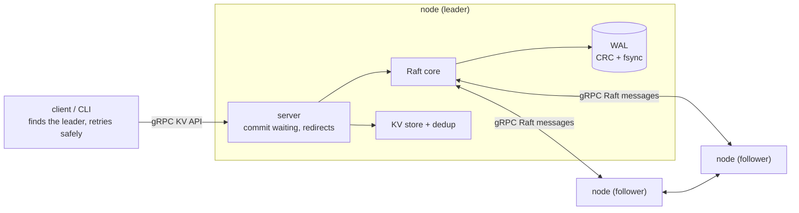
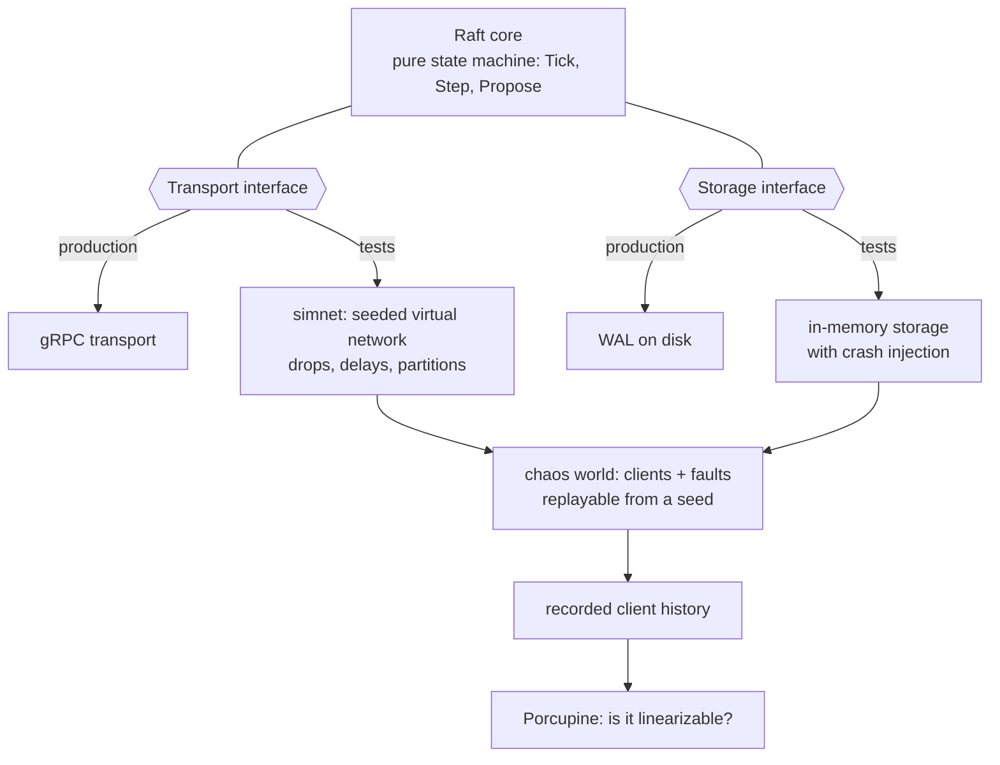

# RaftKV design notes

This document records decisions, tradeoffs, and the bugs the chaos tester found.

## Goals and non-goals

**Goals**
- Linearizable `Get`, `Put`, `Delete`, `CompareAndSwap`.
- Committed writes survive crashes, restarts, and partitions.
- Every claim of correctness backed by a reproducible test.

**Non-goals**
- Sharding, multi-region, dynamic membership.

## Architecture

Each node runs four layers. The **server** (`internal/server`) accepts client commands, hands them to Raft, waits for them to commit, and replies, redirecting to the leader when it is not the leader. The **Raft core** (`internal/raft`) is a pure state machine: it is driven only by `Tick` (logical time), `Step` (an incoming message), and `Propose`, and it reaches the outside world only through a `Transport` and a `Storage` interface. The **state machine** (`internal/kv`) applies committed commands in order and deduplicates retries by `(ClientID, Seq)`. The **WAL** (`internal/storage`) is the durable log: checksummed, fsynced before any reply.

**Why the Raft core is built this way.** It never reads a clock, opens a socket, or touches a file. In production the interfaces are backed by gRPC and the WAL. In tests the same core runs on a seeded virtual network and in-memory storage that can crash on command, so a whole cluster runs in one thread and any failure replays exactly from its seed.

**Life of a write.** A client sends `Put` with a `(ClientID, Seq)` to any node. A follower answers with the leader's address. The leader appends the command to its log (on disk first, then in memory) and sends it to the followers. Once a majority has stored it, and it belongs to the leader's current term, it is committed. Each node applies committed entries in order, the leader's waiting request completes with the result, and the client gets its reply. A retry with the same `(ClientID, Seq)` returns the saved result instead of applying the command twice.

## Raft implementation notes

Code is in `internal/raft`. Done so far, with the decisions worth being able to explain:

**Leader election** (`node.go`: `startElection`, `handleRequestVote`)
- Time is logical: the driver calls `Tick`, and timeouts are counted in ticks. That is what makes a whole cluster replayable from a seed.
- The vote and the term are persisted before the reply leaves the node, so a restart cannot cause a double vote in one term. `TestVoteSurvivesRestart` pins this.

**Log replication** (`node.go`: `sendAppendEntries`, `handleAppendEntries`, `advanceCommit`)
- *Followers never truncate a matching entry.* Only a conflicting entry (same index, different term) triggers deleting the suffix. A delayed or duplicated AppendEntries carrying old entries must not shorten a log that has moved on.
- *The follower's commit index is capped at the last entry the message verified* (`min(leaderCommit, prevLogIndex + len(entries))`). Entries after that point may still differ from the leader's log.
- *A leader commits by counting replicas only for entries from its own term* (Figure 8). Earlier-term entries commit indirectly, when a current-term entry above them does. `TestLeaderCommitsOnlyCurrentTermEntriesByCounting` reproduces the case.
- *A new leader appends a no-op entry.* Without one, a leader with no client traffic could not commit entries inherited from earlier terms. State machines ignore no-ops (`LogEntry.IsNoOp`).
- *Two fields beyond Figure 2 in `AppendEntriesReply`.* `MatchIndex` lets the leader record exactly what a follower holds, so duplicated or reordered replies cannot corrupt `matchIndex` (it only moves forward). `LastLogIndex` lets the leader skip back past a short follower log in one step instead of one index at a time.
- Catch-up is bounded to 64 entries per message and pipelined: each success reply triggers the next batch immediately.

**PreVote** (`node.go`: `startPreVote`, `handlePreVote`, `handlePreVoteReply`; Raft thesis section 9.6)
- *The problem.* Without it, a node cut off from the cluster times out over and over, and every timeout raises its term. When the network heals, that inflated term deposes a healthy leader even though no election was needed. `TestRejoiningNodeDoesNotDisruptStableLeader` reproduces it: before the fix, a follower isolated for 300 ticks came back and turned "leader 2, term 1" into "leader 0, term 21".
- *The fix.* When the election timer fires, a node first asks the others "would you vote for me?" (`PreVoteArgs`, carrying the term it would use) without changing its own term or vote. Only a majority of yes answers starts a real election. An isolated node gets no answers, so its term never moves.
- *When a node says yes.* The candidate's would-be term is ahead of ours, its log is at least as up to date as ours, and we have not heard from a leader for at least the minimum election timeout. A node that is following a live leader (or is the leader) says no; that is the whole point.
- *Answering a pre-vote changes nothing:* no term change, no vote used, no timer reset, no disk write (`TestPreVoteChangesNothing`, `TestIsolatedNodeNeverRaisesItsTerm`). If it did, PreVote would itself become a way to disrupt the cluster or to vote twice.
- *Replies carry the round they answer* (`PreVoteTerm`), so a late reply to an old round cannot start an election (`TestStalePreVoteRepliesAreIgnored`).
- *Liveness is preserved:* when a leader really is unreachable, the nodes that lost it stop hearing from it, agree to a pre-vote, and elect a replacement (`TestPreVoteStillReplacesAnUnreachableLeader`). The cost is one extra message round before each election.
- *Mutation-tested.* Eleven injected bugs (ignore the leader check, ignore log recency, bump the term while pre-voting, consume the real vote, skip the round check, and others) are each caught by a test. The twelfth mutant (a leader granting pre-votes) is equivalent: a leader's election timer never advances, so the "heard from a leader recently" rule already refuses it. The explicit leader clause is kept for clarity.

**Still to do**
- Log compaction and snapshots (phase 6).

## Durability

Code is in `internal/storage` (the WAL) and `internal/raft/storage.go` (the interface).

- **Persist before you reply.** Term, vote, and log entries reach disk before any RPC reply that depends on them leaves the node. The node writes to storage first and updates its memory second, so a crash in between loses nothing it had promised. `TestRepliesNeverOutrunTheDisk` crashes the storage at every operation of a message handler and checks that no reply is backed by state that is not on disk; reordering a reply before the vote is saved fails it.
- **Incremental storage interface.** `SaveHardState`, `Append`, `TruncateFrom`. Rewriting the whole log on every append would make each write O(log size). A storage failure panics the node: carrying on after failing to remember a vote could break safety.
- **Record format.** `crc32c | bodyLen | type + payload`, little endian. The checksum covers the length field and the body, so a damaged length cannot pass as a valid record. Record types are hard state, entry, and truncate; replaying them in order reproduces the state.
- **fsync before returning.** Each call syncs once, including a whole `Append` batch. `Options{NoSync}` exists for benchmarks only. The directory is synced when the file is created (skipped on Windows, which cannot open a directory for syncing).
- **A failed write or sync poisons the WAL.** After a failed fsync the kernel may have dropped dirty pages, so the file's contents are unknowable. The only safe move is to stop and recover from disk with a fresh `Open`.
- **Torn tail versus corruption.** A crash can leave the final record half-written, which recovery discards and cuts off. Damage anywhere else must not be skipped, because dropping committed history could break safety. The rule: a record that runs past the end of the file is torn; a checksum mismatch is torn only if nothing but zeros follows it (if later bytes are non-zero, a later write completed, so this record was damaged after being written); a zero length is torn only if the rest of the file is zeros. Everything else, including a valid record with impossible contents (an index gap, a term going backwards), is `ErrCorrupt`.
- **Known limitation.** Damage to a middle record's length field that makes it look like it runs past the end of the file is indistinguishable from a torn tail, so recovery treats it as one and discards the rest of the log. A real system would add a per-file header or footer checksum, or sync a commit marker, to tell them apart.

## Server layer and API

Code is in `internal/server` (logic), `internal/rpc` (gRPC adapters), `internal/client`.

- **The server layer has no gRPC in it.** `server.Server` joins a Raft node to the KV store and exposes `Submit`/`Execute`; gRPC is a thin adapter over it. That keeps everything interesting running on the deterministic simulated network: the commit-waiting and redirect logic is tested with the same seeded failure injection as the Raft core.
- **Waiting for commit.** `Submit` proposes the command and registers a waiter keyed by the log index it landed at, remembering the term of the proposal. When that index is applied, the waiter gets the result only if the applied entry has the same term; otherwise a different entry replaced the proposal and the client is told `ErrLostLeadership`. This includes the case where a new leader's no-op lands at that index. A bug where waiters were not completed for no-ops was found by `TestDeposedLeadersPendingCommandFails`.
- **A leader that cannot commit never says so.** A leader cut off from a majority keeps its entries forever, so every wait is bounded by the request timeout. The client then retries with the same `(ClientID, Seq)`, and the store's dedup makes the retry safe whether or not the first attempt committed.
- **Reads go through the log** (same path as writes), so they are linearizable at the cost of a log round trip.
- **Node-to-node wire protocol.** The Raft core treats a reply as an independent message that may be lost, late, or duplicated, so the wire protocol is one fire-and-forget `Raft.Step(RaftMessage)` RPC with a `oneof` payload, rather than request/response pairs. The sender never blocks: each peer has a bounded queue and a message that does not fit is dropped, which Raft's retransmission tolerates. This matters because the node holds its lock while sending.
- **Redirects.** A non-leader answers with the address it believes the leader has (`-client-addrs` lets nodes advertise addresses clients can actually reach, which differ from in-cluster addresses under Docker).
- **PreVote** is implemented; see the Raft implementation notes above. (It was a documented gap until the live demo showed a restarted node forcing an extra election.)

## Linearizability checking

Code is in `internal/chaos` (the simulated world and its clients) and `test/linearizability` (the Porcupine model and the tests).

- **What is checked.** Each run builds a cluster of real `server.Server` nodes on the simulated network, with 3 or 5 nodes, 4 clients, and a small key space (2 keys, so operations contend). While clients issue Put/Get/Delete/CAS, the world drops messages, partitions the network (including cutting off the current leader), and crashes nodes at arbitrary storage operations before restarting them from their storage alone. Every client operation is recorded with its call and return time in virtual nanoseconds, and the history is checked against a sequential model of the store with [Porcupine](https://github.com/anishathalye/porcupine).
- **Indeterminate operations.** If a client never learns the outcome (it gives up after a timeout, or walks away right after sending), the command may or may not have taken effect, at any time after it was called. Such an operation is recorded with an infinite return time and an output the model accepts. It is never recorded as "did not happen": a timed-out write that actually committed is exactly the case a checker must not paper over.
- **Retries are safe because of dedup.** A client reuses one `(ClientID, Seq)` for every retry of an operation, so a command that committed but whose reply was lost is not applied twice. Each client has one operation in flight, because the store keeps only the last result per client.
- **Per-key partitioning.** Keys are independent in the model, so each key's history is checked separately, which keeps the search small enough to run hundreds of seeds in seconds.
- **Reproducibility.** The same seed gives the same history (`TestRunsAreDeterministic`). A failing seed prints its replay command and writes Porcupine's HTML visualization to `test/linearizability/failure-seed-N.html` (git-ignored). `RAFTKV_CHAOS_SEEDS` and `RAFTKV_CHAOS_FIRST_SEED` choose how many seeds to run and where to start; CI runs 200 by default.
- **The checker can fail.** A checker that has never failed proves nothing, so the tests break the system on purpose and require a violation to be reported:
  - harness-level bugs (`TestCheckerCatchesStaleReads`: reads served from a node's local state instead of the log; `TestCheckerCatchesMissingDedup`: retries applied twice);
  - bugs injected into the real code in a scratch copy, each caught by the chaos test within a few seeds: committing with less than a majority, granting votes without the log up-to-date check, completing a waiting client with a different entry's result (skipping the term check in `server.apply`), and the dedup cache returning the wrong result.
- **What chaos does not find, and why both kinds of test exist.** Removing the Figure 8 rule (letting a leader commit an entry from an older term by counting replicas) survived 3,000 chaos seeds undetected, while the targeted unit test `TestLeaderCommitsOnlyCurrentTermEntriesByCounting` catches it immediately. The anomaly needs a very specific sequence of leader crashes that random chaos on small clusters, with a no-op appended at the start of every term, almost never produces. Random testing finds bugs nobody thought of; targeted tests pin the ones people know about.

## Client semantics

- **Linearizable reads.** Reads go through the log, so they observe all earlier committed writes. Possible later optimization: read leases or ReadIndex, with the tradeoffs written down.
- **Exactly-once writes.** Each request carries `(client_id, seq)`. The state machine returns the cached result for a retry (see `internal/kv`).
- **Leader redirects.** A non-leader replies with a hint and the client retries.

## Testing strategy

- Unit tests per component.
- Deterministic simulation: whole cluster on `internal/simnet`, driven by a seed.
- Fault injection: partitions, crashes and restarts at arbitrary points, message drop, delay, duplication, reordering.
- Crash injection (`crash_test.go`): a node can crash at any storage operation, with the operation either reaching the disk or not, then restarts from nothing but its storage. `TestCrashAtEveryStorageOperation` crashes each node at each of its storage operations in turn; `TestSafetyUnderRandomCrashes` and `TestSafetyUnderCrashesAndPartitions` crash randomly. Every event checks Election Safety, Log Matching, State Machine Safety, no phantom commands, and that a running node's memory equals its disk.
- WAL tests (`internal/storage`): model-based against `MemoryStorage`, the file cut at every byte offset (and zero-filled after the cut), a bit flipped in every byte, plus an end-to-end node restart.
- Mutation testing: bugs deliberately injected (a vote, term, or entry not persisted, a reply sent before the vote is saved, a missing checksum check, a torn tail left in place, and others) must each fail a test.
- Linearizability checking of recorded operation histories with Porcupine.
- Race detector (`go test -race`) in CI.

## Bugs found by the chaos tester

Add a row for every bug, with the seed that reproduces it and the regression test that now covers it.

| # | Symptom | Root cause | Seed | Regression test |
|---|---------|-----------|------|-----------------|
| 1 | A client whose leader was deposed and whose entry was replaced waited forever instead of being told the command failed | `server.apply` returned early for no-op entries, so a waiter registered at an index that a new leader's no-op took over was never completed | 1 (deterministic scenario) | `TestDeposedLeadersPendingCommandFails` |

## Benchmarks

TODO: throughput and p50/p99 latency for 1, 3, and 5 nodes; time to elect a new leader after the old one is killed. State the hardware, the workload, and what bounded each number.

## Open questions

- Is a single `Apply` callback enough, or should committed entries be delivered on a channel?
- When to take snapshots: by log size, by entry count, or on a timer?
